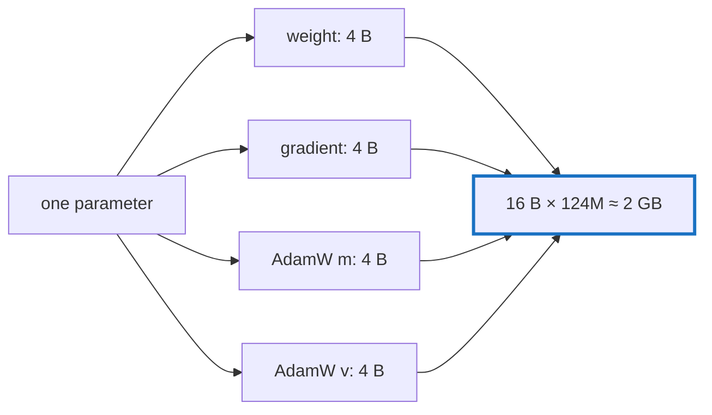

# Q-BB: How much memory does fine-tuning GPT-2 small take before activations?

*[Fine-tuning](README.md#fine-tuning) · first in the theme · next: [Q-BC](q-bc-what-a-checkpoint-holds.md)*

## The question

Fine-tuning keeps AdamW's `m` and `v` for every parameter. For GPT-2 small's 124M parameters in F32, how much memory do the weights, gradients, `m` and `v` take together, and which machine would that strain?

> **Hint:** count the floats kept per parameter.

<strong>Answer</strong>

### In short

About 2 GB: 124.4M parameters × 4 floats (weight, gradient, `m`, `v`) × 4 bytes. Activations come on top and depend on the batch: at 8 × 256 the logits alone, `[2048, 50257]`, are about 0.4 GB, and their gradient and softmax as much again. Neither the GB10 nor the M5 Pro is strained. The same arithmetic gives 12 GB for GPT-2 large and 25 GB for XL, where activations, not state, decided what fitted.

### An analogy

A builder's kit: for each brick in the wall, the brick, a note of how to move it, and two notebooks of its recent moves. Four things per brick, whatever the wall.

### Worked example

Model      |Parameters|State, F32 × 4|Measured step peak on the GB10                 
-----------|----------|--------------|-----------------------------------------------
GPT-2 small|124M      |2.0 GB        |—                                              
GPT-2 large|774M      |12.4 GB       |about 34 GB of device memory, after Decision CD
GPT-2 XL   |1,558M    |24.9 GB       |out of memory in step 1, before Decision CD    

### Where it shows up in tensomite

`bench/train_gpt2.cr` prints the state's size before it trains ("weights, gradients and AdamW state"), and `finetune` reports device memory in its progress lines (Decision CC).

## See also

- [Q-BC](q-bc-what-a-checkpoint-holds.md): what a checkpoint must hold besides this state.
