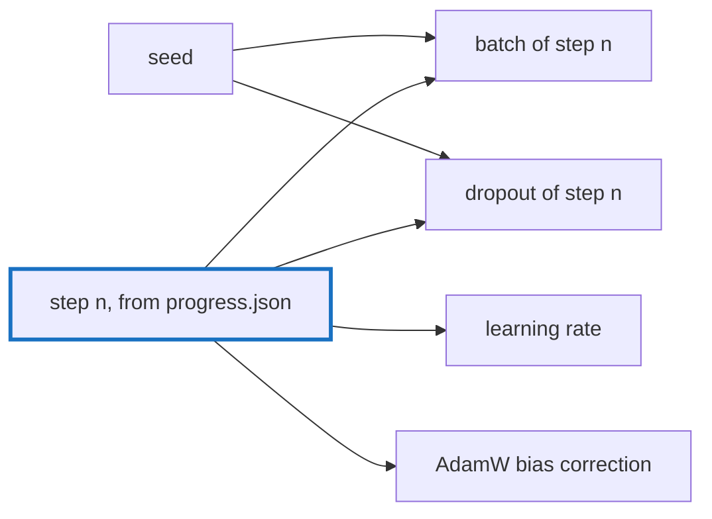

# Q-BC: What must a checkpoint hold for a resumed run to match one that never stopped?

*[Fine-tuning](README.md#fine-tuning) · previous: [Q-BB](q-bb-memory-of-a-training-step.md) · next: [Q-BE](q-be-why-dropout-helps.md)*

## The question

Tensomite's results are deterministic, so a run resumed from a checkpoint could match an uninterrupted one bit for bit. What besides the weights and AdamW's `m` and `v` must the checkpoint hold?

> **Hint:** think about everything that decides which tokens step 1,001 trains on, and with what learning rate.

<strong>Answer</strong>

### In short

Everything the rest of the run depends on that is not fixed in advance: the step count `t`, which sets AdamW's bias correction and the learning rate on its schedule, and the early-stopping state, the best validation loss so far and how many checks since it. What decides the data is made not to need saving: the batch of step *n* comes from a generator seeded with the run's seed and *n*, and so does its dropout, so there is no generator state to keep. The schedule is a function of the step and the settings, which are saved once. And the text is the tokenised copy in the run, not the text file, which may have changed since.

### An analogy

A recipe followed to the gram. To pick up where you stopped you need the dish so far and which step you were on; you do not need to remember which spoon you used, if the recipe says which spoon each step takes.

### Worked example

What `finetune` writes, and why each is there:

File                              |Holds                                      |Needed for                              
----------------------------------|-------------------------------------------|----------------------------------------
`checkpoint/model.safetensors`    |weights                                    |the model                               
`checkpoint/optimizer.safetensors`|`m` and `v` per parameter                  |AdamW's next update                     
`checkpoint/progress.json`        |step, best validation loss, checks since it|bias correction, learning rate, patience
`settings.json`                   |every setting, written once                |the schedule, batch size, seed          
`tokens.bin`, `split.json`        |the tokenised text and its split           |the batches                             

### Where it shows up in tensomite

`Finetune::Trainer#checkpoint` writes these to `checkpoint.new/` and swaps it in. A spec trains three steps, checkpoints, resumes and trains three more, and compares every bit of the weights and state with a run of six (Decision BV).

## See also

- [Q-BB](q-bb-memory-of-a-training-step.md): the size of the state a checkpoint saves.
