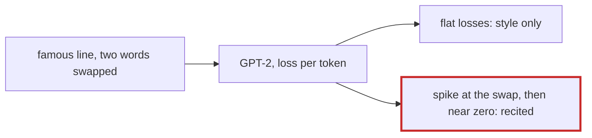

# Q-BD: How could you test whether GPT-2 memorised a passage?

*[Fine-tuning](README.md#fine-tuning) · previous: [Q-BI](q-bi-when-validation-follows-training.md) · next: [Q-BM](q-bm-what-patience-costs.md)*

## The question

With nothing but the tools in tensomite, how could you test whether GPT-2 memorised specific passages, such as Shakespeare's most famous lines?

> **Hint:** compare the loss on "To be, or not to be, that is the question" with the loss on a line of similar style from an obscure scene, and on the famous line with two words swapped. What would memorisation look like in those numbers?

<strong>Answer</strong>

### In short

Compare per-token losses. A model that has merely learned the style gives a famous line and an obscure line of the same kind similar losses. One that memorised the famous line gives it a far lower loss, falling as the line goes on, since each word makes the next certain. The swapped version is the sharpest test: memorisation shows as a spike of loss exactly at the swapped words and a quick return to near zero after them, because the model is reciting, not composing. Tensomite has the pieces: `GPT2#forward` gives logits for every position, and `bench/code_eval.cr`'s body loss is this sum over a chosen span. Not yet run.

### An analogy

Telling recall from fluency in a person: ask them to continue a famous speech and an obscure one, then misquote the famous one. Someone who knows it by heart stumbles at the misquote and picks the speech straight back up.

### Worked example

The prediction, not a measurement:

Text                          |If only the style was learned|If the line was memorised         
------------------------------|-----------------------------|----------------------------------
Famous line                   |moderate loss                |very low, falling along the line  
Obscure line, same style      |moderate loss                |moderate loss                     
Famous line, two words swapped|moderate loss                |spike at the swap, near zero after

### Where it shows up in tensomite

`CodeEval.body_loss` sums the cross-entropy over a span after a prompt; the same few lines over a chosen text would run this test. The code evaluation avoids the question by measuring only files held out of fine-tuning, though GPT-2's own pretraining may have seen them.

## See also

- [Q-BE](q-be-why-dropout-helps.md): what memorising does to validation loss.
