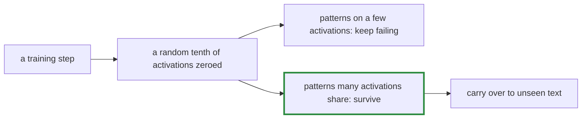

# Q-BE: Why does damaging a model with dropout make it better on unseen text?

*[Fine-tuning](README.md#fine-tuning) · previous: [Q-BC](q-bc-what-a-checkpoint-holds.md) · next: [Q-BI](q-bi-when-validation-follows-training.md)*

## The question

Fine-tuning GPT-2 small on Tiny Shakespeare, training loss kept falling after step 200 while validation loss rose. What changed in what the model was learning? And why would dropout, which deliberately damages the model at every step, help?

> **Hint:** think about what a model can rely on when random parts of it are missing at every step.

<strong>Answer</strong>

### In short

After step 200 the model stopped learning Shakespeare and started learning the file: exact phrases and who speaks after whom in particular scenes, patterns that lower training loss and exist nowhere else. Dropout zeroes a random tenth of the activations at every step, so a pattern that hangs on a few precise activations, as memorising a phrase does, keeps failing. Only patterns many activations agree on survive, such as verse rhythm, speaker headings and vocabulary, and those carry over to unseen text. Measured: the best validation loss moved from step 200 to step 500, and after it validation rose 0.03 in 200 steps rather than 0.41 in 500.

### An analogy

A team where anyone may be absent on a given day. No one can be the only person who knows a fact, so the knowledge gets spread around.

### Worked example

Validation loss on Tiny Shakespeare, GPT-2 small, validated every 50 steps:

Step|Without dropout |With dropout 0.1
----|----------------|----------------
200 |**3.344** (best)|3.350           
500 |3.449           |**3.315** (best)
700 |3.756           |3.348           

### Where it shows up in tensomite

`Op::Dropout` hashes the seed and each element's position, so every device makes the same mask; `finetune` uses 0.1 by default, seeded by the step (Decision BY).

## See also

- [Q-BI](q-bi-when-validation-follows-training.md): a run where validation never parted from training.
