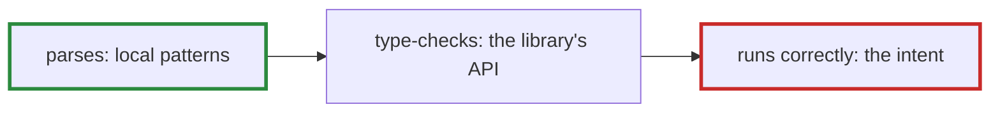

# Q-BF: Where would a fine-tuned model's code fail most: parsing, types or behaviour?

*[Evaluating code](README.md#evaluating-code) · first in the theme · next: [Q-BJ](q-bj-why-greedy.md)*

## The question

Before the first code fine-tune, predict where its code fails most often: parsing, type-checking, or running correctly.

> **Hint:** compare what each check needs the model to know. Parsing needs local patterns, like `def` … `end` and balanced brackets. Type-checking needs to know what methods exist on `Int32` or `Array`. Running correctly needs to understand what the method is for.

<strong>Answer</strong>

### In short

In that order, least to most: each check needs more than the one before. Measured on 200 held-out methods, fine-tuned GPT-2 large's completions (the 9,000-step schedule) parsed 85% of the time, but matched the original body exactly once, and most of those read show plausible code doing the wrong thing, such as `last_key` returning `entry.value`. Type-checking turned out not to be measurable this way: Crystal checks only the methods a program calls, so `crystal build --no-codegen` passes a method whose body calls a name that does not exist. Testing behaviour would need tests written for each method.

### An analogy

Learning a language: grammar first, then vocabulary, then saying what you mean. A fluent-sounding sentence can still say the wrong thing.

### Worked example

Fine-tuned GPT-2 large, 9,000-step schedule, 200 held-out methods:

Check               |Needs                 |Passed                 
--------------------|----------------------|-----------------------
Closes with `end`   |layout                |87%                    
Parses              |grammar               |85%                    
Type-checks         |the library's methods |not measurable this way
Matches the original|what the method is for|0.5% exactly           

### Where it shows up in tensomite

`bench/code_eval.cr` checks closing and parsing with `crystal tool format`, and explains in its header why it does not type-check (Decision BZ).

## See also

- [Q-BN](q-bn-loss-and-first-lines.md): what the loss measures that matching does not.
