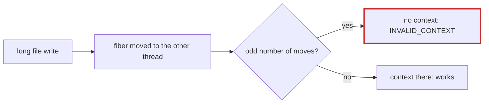

# Q-BG: Why did the fine-tune fail at the third validation, not the first?

*[GPU runtime and lifetimes](README.md#gpu-runtime-and-lifetimes) · previous: [Q-AK](q-ak-emulating-barriers.md) · next: [Q-BH](q-bh-isolated-and-finalizers.md)*

## The question

A fine-tune on CUDA passed validations at steps 250 and 500, each exporting `best/`, and failed with `CUDA_ERROR_INVALID_CONTEXT` only at step 750. What decides which validation fails?

> **Hint:** the context is current on one OS thread; when does the main fiber change threads?

<strong>Answer</strong>

### In short

Whether the main fiber is on the thread that holds the CUDA context when it next calls the driver. Crystal 1.22 moves a fiber to another thread when a blocking file write takes long enough for the runtime's monitor to hand the scheduler to a new thread. Writing the log, `best/` and checkpoints can each move it, depending on how long each write takes. If the count of moves since the context was set is odd, the next upload lands on a thread with no context. So which validation fails depends on how long the writes took, not on the step: it was step 750 by chance. Making the context current on each call when the thread changes removes the question.

### An analogy

A hotel that quietly moves you to the room next door whenever you take a long phone call. Your key card works in your first room only, so whether it works tonight depends on how many long calls you made.

### Worked example

Measured here: 50 file writes of 50 MB each, checking the OS thread after each:

Write |Thread                
------|----------------------
before|A                     
1     |B                     
2     |A                     
3     |B                     
…     |alternating every time

### Where it shows up in tensomite

`CUDA::Context#bind` makes the context current when the calling thread differs from the last call's, and the CUDA stub keeps a context per thread so the specs catch a call that skips it (Decision CA).

## See also

- [Q-BH](q-bh-isolated-and-finalizers.md): why pinning the fiber would not be enough.
- [Q-BK](q-bk-per-fiber-not-per-thread.md): the same mistake in another design.
