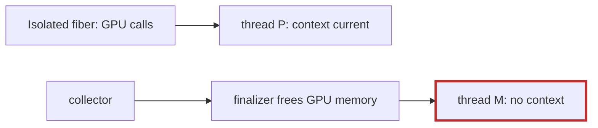

# Q-BH: Why can't an `Isolated` context alone make finalizers safe?

*[GPU runtime and lifetimes](README.md#gpu-runtime-and-lifetimes) · previous: [Q-BG](q-bg-which-validation-fails.md) · next: [Q-BK](q-bk-per-fiber-not-per-thread.md)*

## The question

Crystal's `Fiber::ExecutionContext::Isolated` pins one fiber to one OS thread. If all of a program's GPU calls ran inside it, the CUDA context could be set once. Why would finalizers still need their own handling?

> **Hint:** on which thread does a finalizer run?

<strong>Answer</strong>

### In short

Finalizers do not run in the isolated fiber. The collector runs them on whichever thread is allocating when it collects, and in Crystal 1.22 also on the runtime's monitor thread, which is never the isolated one. A finalizer that frees GPU memory therefore calls the driver from a thread where the context may not be current. Pinning the fiber covers the code you wrote, not the code the collector runs for you, so `free_from_any_thread` must make the context current itself, and the library would still need its guard.

### An analogy

Giving one employee the only key to the safe, then letting the night cleaner put things away in it. The cleaner needs a key too.

### Worked example

Code                                |Runs on                              |Context current?     
------------------------------------|-------------------------------------|---------------------
The training loop, inside `Isolated`|its pinned thread                    |yes, set once        
A buffer's finalizer                |the collecting thread, or the monitor|not unless it sets it

### Where it shows up in tensomite

`CUDA::Context#free_from_any_thread` calls `cuCtxSetCurrent` before `cuMemFree`, and Decision CA keeps a per-call check rather than requiring apps to use `Isolated`.

## See also

- [Q-U](q-u-finalizer-and-lock.md): why a finalizer cannot wait for a lock either.
- [Q-BG](q-bg-which-validation-fails.md): the bug that raised this.
