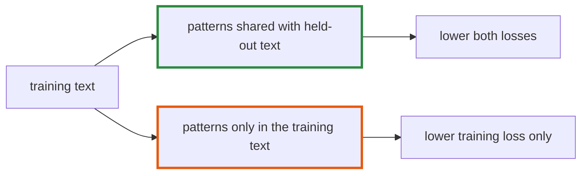

# Q-BI: Why did validation loss follow training loss on code but not on Shakespeare?

*[Fine-tuning](README.md#fine-tuning) · previous: [Q-BE](q-be-why-dropout-helps.md) · next: [Q-BD](q-bd-testing-for-memorised-passages.md)*

## The question

Fine-tuning GPT-2 small on Crystal's standard library, validation loss stayed close to training loss for all 6,000 steps, 3.3 passes over the text. On Tiny Shakespeare they parted after about 1.3 passes. What about the two texts explains the difference?

> **Hint:** what can a model learn from the training text that is useless on the held-out part?

<strong>Answer</strong>

### In short

How much of what the training text teaches is specific to it. The Crystal corpus is twelve times larger, 3.7M training tokens against 270K, and its held-out files share the training files' idioms, APIs and layout, because one project wrote them all: almost every pattern that lowers training loss also lowers it on the held-out files. Tiny Shakespeare's held-out tenth is the end of the text, other scenes with other speakers, and what the model could memorise about the first nine tenths did not transfer. The code run also had dropout 0.1 from the start, which the first Shakespeare run did not. I think the text matters more than dropout here, since dropout on Shakespeare delayed the parting but did not stop it.

### An analogy

Practising for an exam from past papers. If the exam is set by the same examiner on the same syllabus, practice transfers; if it is on another book, memorising the past papers stops helping early.

### Worked example

Run                     |Training tokens|Passes             |Dropout|Gap at the end                    
------------------------|---------------|-------------------|-------|----------------------------------
Shakespeare, GPT-2 small|270K           |about 5 by step 700|0      |about 1.45 at step 700            
Shakespeare, GPT-2 small|270K           |about 5 by step 700|0.1    |about 0.35 at step 700            
Crystal, GPT-2 small    |3.7M           |3.3                |0.1    |about 0, both near 1.0            
Crystal, GPT-2 large    |3.7M           |2.6                |0.1    |validation rising after 1.8 passes

### Where it shows up in tensomite

`scripts/make_code_corpus.sh` shuffles whole files, so the held-out tenth is files from every part of the library rather than its alphabetical end (Decision BZ). GPT-2 large, six times bigger, did start memorising, after about 1.8 passes (Decision CB).

## See also

- [Q-BE](q-be-why-dropout-helps.md): how dropout delays memorising.
- [Q-BM](q-bm-what-patience-costs.md): stopping once validation stops improving.
