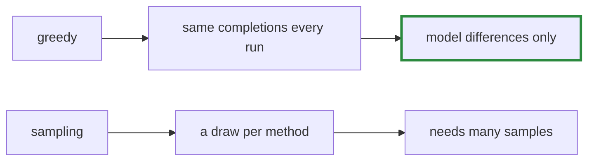

# Q-BJ: Why evaluate with greedy decoding, loops and all?

*[Evaluating code](README.md#evaluating-code) · previous: [Q-BF](q-bf-where-code-fails.md) · next: [Q-BN](q-bn-loss-and-first-lines.md)*

## The question

Sampling at temperature 0.8 would break some of the loops greedy decoding falls into, like `builder.builder.builder…`. Why does `bench/code_eval.cr` decode greedily anyway?

> **Hint:** what would a second run of the evaluation give, with each?

<strong>Answer</strong>

### In short

Greedy decoding is deterministic: the same model on the same methods gives the same completions and the same table every time, so a difference between two models is a difference between the models, not between two rolls of the dice. With sampling, each method's result is a draw, and a fair comparison needs many samples per method, multiplying the cost. Greedy also shows each model's single most likely continuation, and falling into a loop is part of what that measures. The cost is that it reports what the model does by default, not the best it could do with a sampler.

### An analogy

Comparing two cars on a fixed route rather than letting each driver choose: less like real driving, but any difference is the car.

### Worked example

Choice         |Same table twice?|Samples per method for a fair comparison|Loops              
---------------|-----------------|----------------------------------------|-------------------
Greedy         |yes              |1                                       |counted as failures
Sampling at 0.8|no               |several, at several times the cost      |often escaped      

### Where it shows up in tensomite

`CodeEval.complete` uses `GPT2#generate` with its default, greedy `Sampler` (Decision BZ).

## See also

- [Q-BN](q-bn-loss-and-first-lines.md): a measure that needs no decoding at all.
