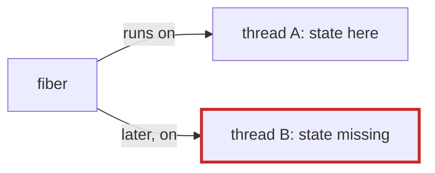

# Q-BK: Why must per-task state follow the fiber, not the thread?

*[GPU runtime and lifetimes](README.md#gpu-runtime-and-lifetimes) · previous: [Q-BH](q-bh-isolated-and-finalizers.md) · next: [Q-BL](q-bl-buffers-a-write-fills.md)*

## The question

A design for memory arenas in Crystal kept the "current arena" in a `@[ThreadLocal]` variable and noted it would work with one thread but fail now and then with execution contexts. Which bug of tensomite's was the same mistake, and what was the fix?

> **Hint:** what moved in [Q-BG](q-bg-which-validation-fails.md)?

<strong>Answer</strong>

### In short

The CUDA context. Both put state the code relies on in a place tied to the OS thread, assuming the code stays on that thread, and Crystal's execution contexts move fibers between threads. The arena design's fix is to keep the stack of arenas on the `Fiber`; tensomite's could not move CUDA's context, which the driver keeps per thread, so it checks the thread on each call and makes the context current when it has changed.

### An analogy

Leaving your notes on a desk in a hot-desking office: the next time you sit down it may be another desk. Keep them in your bag, or check the desk each time.

### Worked example

Design                 |State          |Kept on                  |Fails when                        |Fix                          
-----------------------|---------------|-------------------------|----------------------------------|-----------------------------
Arena allocator        |current arena  |the thread               |the fiber moves                   |keep it on the fiber         
Tensomite's CUDA device|current context|the thread, by the driver|the fiber moves after a long write|check and set it on each call

### Where it shows up in tensomite

`CUDA::Context#bind`, 3.8 ns a call measured here (Decision CA).

## See also

- [Q-BG](q-bg-which-validation-fails.md): the failure itself.
