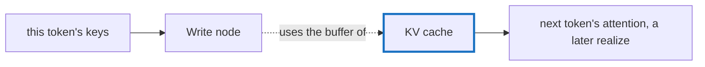

# Q-BL: Why is a buffer a `Write` fills never released mid-step?

*[GPU runtime and lifetimes](README.md#gpu-runtime-and-lifetimes) · previous: [Q-BK](q-bk-per-fiber-not-per-thread.md) · last in the theme*

## The question

`Tensor.realize(tensors, release: true)` frees each intermediate buffer once nothing later in the same realize reads it. Why must a buffer filled by a `Write` node never be freed this way, even when nothing later in the step reads it?

> **Hint:** whose buffer does a `Write` node use, and who reads it next?

<strong>Answer</strong>

### In short

A `Write` node has no buffer of its own: it writes into its target's, such as the KV cache, which the scheduler hands to it. Freeing the `Write` node would free the cache itself, and its readers are not in this realize: they are the next token's decode step. "Nothing later in this step reads it" is the wrong test for a buffer whose purpose is to outlive the step, so the scheduler leaves out both the `Write` node and its target.

### An analogy

A shared whiteboard in a meeting room. When today's meeting ends you clear your own notepads, not the whiteboard tomorrow's meeting will read.

### Worked example

Decoding token 80 with a cache of capacity 1,024:

Node                  |Buffer         |Read by                   |Released at the end of the realize?
----------------------|---------------|--------------------------|-----------------------------------
This token's keys     |its own        |the `Write`               |yes                                
`Write` into the cache|the cache's    |the next token's attention|no                                 
The cache             |its own, a leaf|every later token         |no, and leaves never are           

### Where it shows up in tensomite

`Scheduler.count_readers` leaves out `Write` nodes and their targets, and `spec/release_spec.cr` checks that a written buffer survives a releasing realize (Decision CD).

## See also

- [Q-AD](q-ad-cache-written-in-place.md): why the cache is written in place.
- [Q-V](q-v-encoded-is-not-executed.md): when reusing a buffer is unsafe.
