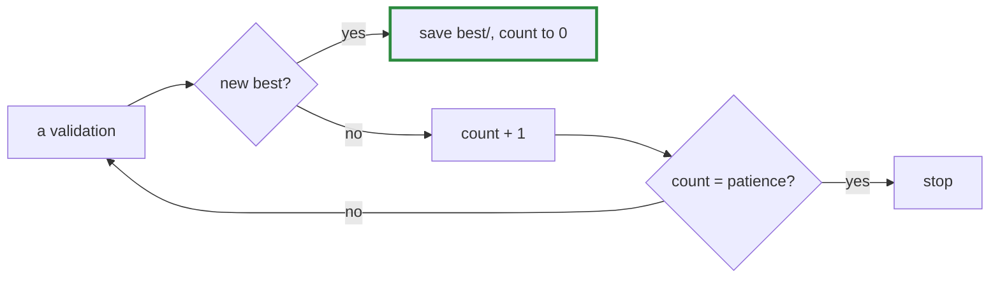

# Q-BM: Why did early stopping run 1,500 steps past the best?

*[Fine-tuning](README.md#fine-tuning) · previous: [Q-BD](q-bd-testing-for-memorised-passages.md) · last in the theme*

## The question

The GPT-2 large run on Crystal kept its best weights from step 3,250 but ran until step 4,750 before stopping, with a patience of 6 and a validation every 250 steps. Why does that patience cost so much extra training, and what would a smaller patience risk?

> **Hint:** what does each validation measure, and how precisely?

<strong>Answer</strong>

### In short

Patience counts validations without a new best: 6 checks × 250 steps is 1,500 steps after the last best, about 66 minutes here. The cost is only time, since `best/` already holds the best weights. A smaller patience would stop sooner, but a validation is 8 batches of 2,048 tokens, a sample with noise of its own, and a cosine schedule can still improve late, as its learning rate falls: the 3,500-step run found its best near the end. Too little patience stops at a bump of noise before the true minimum.

### An analogy

Leaving a party once it stops getting better. Leave at the first lull and you may miss the best hour; wait for six lulls and you will be sure, but home late.

### Worked example

Patience at 250 steps a check|Steps past the best before stopping|Risk                               
-----------------------------|-----------------------------------|-----------------------------------
2                            |500                                |stopping at a noise bump           
6                            |1,500                              |about an hour of training wasted   
0                            |none: runs to the end              |the full schedule, best kept anyway

### Where it shows up in tensomite

`Finetune::Trainer#record` keeps the count in `progress.json`, so a resumed run keeps its patience (Decision BV).

## See also

- [Q-BI](q-bi-when-validation-follows-training.md): why large started memorising.
