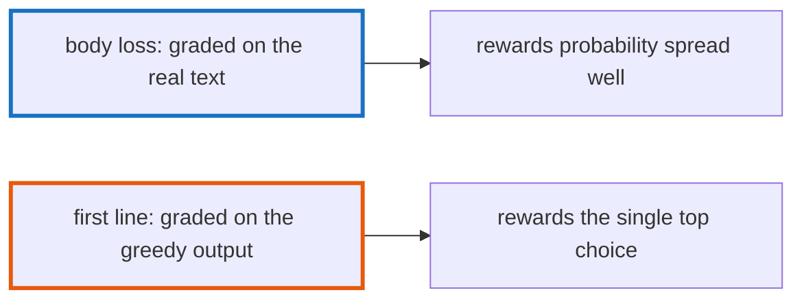

# Q-BN: How can a model have lower loss and fewer matching first lines?

*[Evaluating code](README.md#evaluating-code) · previous: [Q-BJ](q-bj-why-greedy.md) · next: [Q-BO](q-bo-copying-or-coherence.md)*

## The question

Fine-tuned GPT-2 large had a lower body loss than fine-tuned small, 0.79 against 0.93, yet matched the original first line of 16 methods out of 200 against small's 23. How can both be true?

> **Hint:** how is each measure scored: on the real text, or on what the model writes?

<strong>Answer</strong>

### In short

Body loss is scored on the real text: the model is shown the true tokens and graded on the probability it gave each next one, so it rewards spreading probability well across every token of the body. First-line match is scored on what the model writes: one greedy choice at each step, which must equal the original exactly, so it rewards putting the most probability on the single most common option at the start. A model can give the real first line a probability of 0.4 and lose to another option at 0.5: good loss, no match. Here the 11 methods only small matched were mostly ones where small copied a neighbouring method's opening.

### An analogy

Two ways of marking an essay: one gives credit for every sentence that is sensible in context, the other only for an opening sentence that matches the model answer word for word.

### Worked example

On `BigRational#%`, the real first line is `check_division_by_zero other`, as in `/` and `//` just above it in the file:

- **Fine-tuned small** wrote `check_division_by_zero other`: a match.
- **Fine-tuned large** wrote `BigRational.new { |mpq| LibGMP.mpq_mul(mpq, self, other) }`: plausible, but no match.

### Where it shows up in tensomite

`CodeEval.body_loss` and `CodeEval.complete` compute the two; `scripts/compare_first_lines.py` lists the methods where two models' first lines differ (Decision CF).

## See also

- [Q-BO](q-bo-copying-or-coherence.md): which of the two matters for an assistant.
