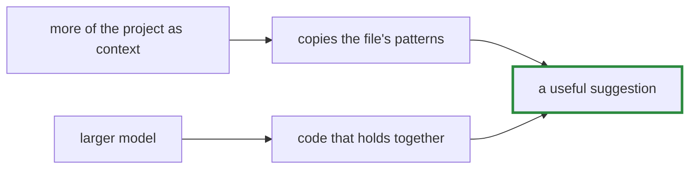

# Q-BO: Copying the file, or code that holds together?

*[Evaluating code](README.md#evaluating-code) · previous: [Q-BN](q-bn-loss-and-first-lines.md) · last in the theme*

## The question

For an assistant completing code in someone's own file, which matters more: small's habit of copying the neighbouring methods, or large's code that more often closes and parses? What would it take to have both?

> **Hint:** what does a programmer reviewing the suggestion check first?

<strong>Answer</strong>

### In short

My view, not a measurement: in someone's own file, following its conventions matters a great deal, since code that uses the file's helpers and idioms is easier to review and more often right; but a suggestion that does not parse is no use at all. Neither model has both. Ways to get both: give the model more of the relevant file or project as context; fine-tune on the user's own repository; generate several candidates and rank them by parsing and by similarity to the file; or a larger model trained for longer, since large saw the text 1.9 times against small's 3.3. Which of these works best here is untested.

### An analogy

A new colleague who either writes in the team's style but with mistakes, or writes correct code in their own style. The ideal reads the codebase first.

### Worked example

Fine-tuned models on 200 held-out methods:

Model                   |Parses|First line matches|Copies a neighbour's opening
------------------------|------|------------------|----------------------------
GPT-2 small             |79.5% |11.5%             |often                       
GPT-2 large, 3,500 steps|82.5% |8%                |less often                  

### Where it shows up in tensomite

The comparison comes from `scripts/compare_first_lines.py` on `bench/code_eval.cr`'s `--verbose` output (Decision CF).

## See also

- [Q-BN](q-bn-loss-and-first-lines.md): why the two measures disagree.
