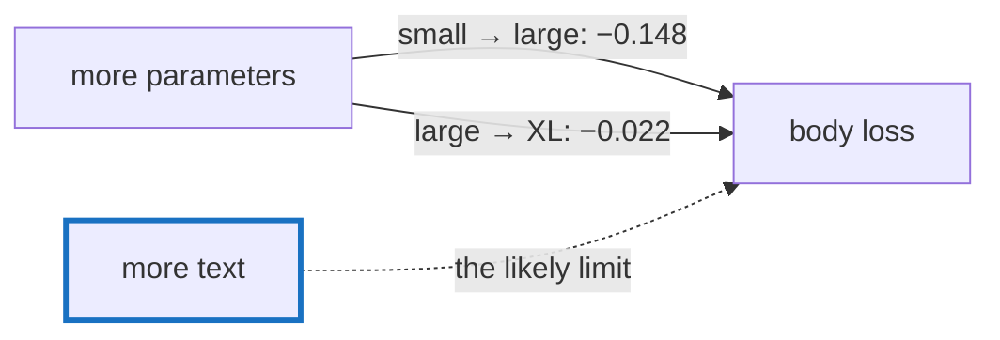

# Q-BP: What would get more out of GPT-2 XL, apart from the model?

*[Fine-tuning](README.md#fine-tuning) · previous: [Q-BM](q-bm-what-patience-costs.md) · last in the theme*

## The question

Fine-tuned on Crystal's standard library, going from GPT-2 large to XL doubled the parameters but cut the body loss by only 0.022, against 0.148 from small to large. What would you change, apart from the model, to get a bigger gain from XL?

> **Hint:** what was the larger model short of?

<strong>Answer</strong>

### In short

The text, most likely. 3.7 million tokens is little for 1.5 billion parameters: XL can memorise much of it before it has learned all that the text could teach, so the gain from size flattens, as it did on Shakespeare. So, in order: more text (more Crystal code, from shards); stronger regularisation (more dropout, weight decay); fewer passes over the same text, with a lower learning rate for the larger model; and a longer context, so each prediction sees more of its file. Untested.

### An analogy

A gifted student with one textbook. A second student, more gifted still, gets little further: they need more books, not more talent.

### Worked example

Fine-tuned on the standard library, on the GB10:

Model      |Body loss             |Typical probability of the real next token|Time a step                
-----------|----------------------|------------------------------------------|---------------------------
GPT-2 small|the baseline          |0.39                                      |—                          
GPT-2 large|0.148 lower than small|0.46                                      |2.7 s                      
GPT-2 XL   |0.022 lower than large|0.47                                      |5.1 s, and twice the memory

### Where it shows up in tensomite

Decision CH records the XL fine-tune; `apps/finetune/README.md` has the table, and `bench/code_eval.cr` the held-out methods.

## See also

- [Q-BE](q-be-why-dropout-helps.md): why dropout helps on unseen text.
- [Q-BM](q-bm-what-patience-costs.md): when to stop.
