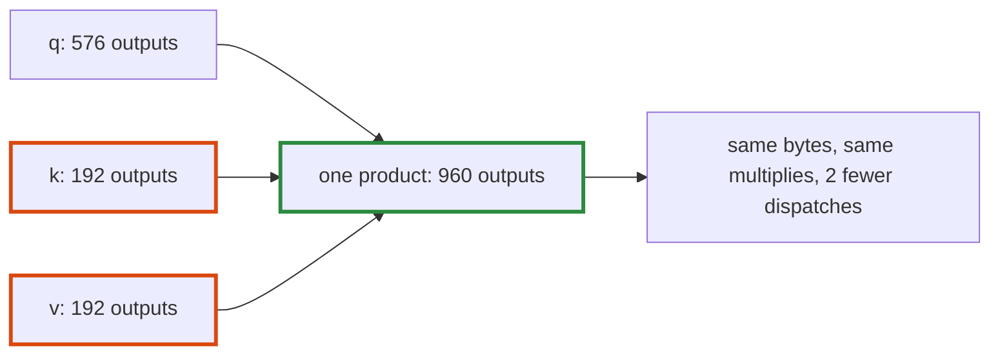

# Q-BR: Why should joining projections save less than fusing RMSNorm and RoPE?

*[Quantised decoding on GPUs](README.md#quantised-decoding-on-gpus) · previous: [Q-BT](q-bt-how-decode-scales.md) · next: [Q-BU](q-bu-the-heads-bandwidth.md)*

## The question

Fusing RMSNorm and RoPE cut SmolLM2-135M's dispatches by about half. Joining the projections that read the same input, queries, keys and values into one product and the MLP's gate and up into another, cuts dispatches too. Why should it save less time per dispatch removed?

> **Hint:** what else did fusing remove, besides the dispatches?

<strong>Answer</strong>

### In short

The prediction: fusing removed whole passes over memory, since each of RMSNorm's seven ops wrote its result out and the next read it back; joining keeps every weight byte and every multiply, and removes only the dispatches. That held on the GB10. On the M5 Pro I was half wrong: each dispatch removed saved about 2½ times as much as fusing had. A key or value product of the 135M model has only 192 outputs, too few to fill the GPU, so it costs about a fixed minimum whatever its size; three joined into one cost about as much as one did.

### An analogy

Three buses carrying three passengers each: merge them into one bus of nine, and the trip takes about as long as one of the three did.

### Worked example

SmolLM2-135M's attention, per layer:

Products                                |Outputs each |Dispatches
----------------------------------------|-------------|----------
`q_proj`, `k_proj`, `v_proj`, separately|576, 192, 192|3         
joined (`Linear.merge`)                 |960          |1         

A product of 192 outputs leaves most of either GPU idle. Why the gain was so much larger on the M5 Pro than on the GB10 is still an open question: compare each machine's time waiting for the GPU with its time launching kernels.

### Where it shows up in tensomite

`Linear.merge`, used by `Llama.load` (Decision CQ's follow-up, #100); fused RMSNorm and RoPE were Decision CQ (#99).

## See also

- [Q-AU](q-au-fewer-launches-less-saving.md): fewer launches, less saving, in training.
- [Q-AW](q-aw-counting-passes-over-memory.md): counting passes over memory.
