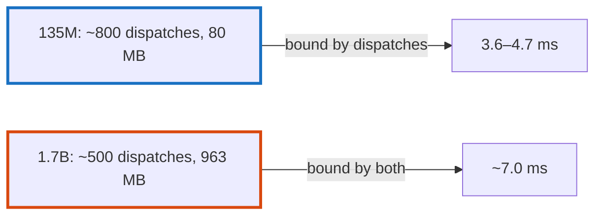

# Q-BT: Does a 13-times larger model decode 13 times slower?

*[Quantised decoding on GPUs](README.md#quantised-decoding-on-gpus) · first in the theme · next: [Q-BR](q-br-joining-projections.md)*

## The question

SmolLM2-1.7B is about 13 times the size of SmolLM2-135M, with 24 blocks instead of 30. Will its decode time on a GPU grow about 13-fold, about 0.8-fold, or somewhere in between?

> **Hint:** what bounds the small model's token: the bytes it reads, or the number of things it does?

<strong>Answer</strong>

### In short

In between, and nearer the low end: about 1.5 to 2 times. A token of the small model was bound by its 800 or so dispatches, each with a fixed cost of a few microseconds whatever it does; a 13-fold model would be 13 times slower only if reading its weights were the whole cost. The large model has fewer dispatches, since it has fewer blocks, and reads 13 times the bytes, so it is partly bound by each, and its time grows far less than its size.

### An analogy

A delivery round: the small van spends its day stopping and starting, not driving. A lorry with thirteen times the load makes fewer stops, and takes longer only for the driving.

### Worked example

Decoding at Q4_0 on the GPUs, before the GPU work of Decisions CU to CZ:

Model                                           |Weights read a token|Dispatches a token|GB10        |M5 Pro      
------------------------------------------------|--------------------|------------------|------------|------------
SmolLM2-135M, before its projections were joined|about 80 MB         |about 800         |3.61 ms     |4.72 ms     
SmolLM2-1.7B, after                             |about 963 MB        |about 500         |about 7.0 ms|about 7.0 ms

At the GB10's 273 GB/s, 963 MB takes 3.5 ms: half of the 1.7B model's token was reading weights, the other half everything else.

### Where it shows up in tensomite

Decision CU, which took the 1.7B model as the GPUs' benchmark and llama.cpp's 4.73–4.85 ms as the target; `bench/profile_decode.cr` (Metal) and `bench/profile_decode_cuda.cr` (CUDA) split a token into its parts.

## See also

- [Q-BR](q-br-joining-projections.md): cutting dispatches by joining products.
- [Q-CC](q-cc-a-launch-bound-profile.md): what a token bound by launches looks like.
