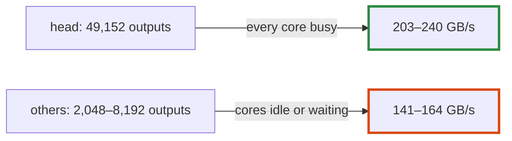

# Q-BU: Why does the output layer read faster than any other product?

*[Quantised decoding on GPUs](README.md#quantised-decoding-on-gpus) · previous: [Q-BR](q-br-joining-projections.md) · next: [Q-BV](q-bv-idle-threads-still-help.md)*

## The question

Decoding SmolLM2-1.7B on the GB10, the output layer reads its weights at 203–240 GB/s, the highest bandwidth of any product, though it does the same kind of work as the others at 141–164 GB/s. What about its shape might explain that?

> **Hint:** count its outputs, and compare them with the GPU's threads.

<strong>Answer</strong>

### In short

It has by far the most outputs: 49,152, one per word of the vocabulary, against 2,048 to 8,192 for the others. That is enough independent work to keep every core of the GPU busy with many requests to memory in flight, which is what it takes to approach the memory's peak; a product with few outputs leaves cores idle, or waiting on one long row each. It is also one large dispatch, so its fixed costs are spread over 100 MB of weights.

### An analogy

A checkout queue: with one long queue and every till open, the shop's throughput nears its limit. A few short queues leave tills idle.

### Worked example

Decode products of SmolLM2-1.7B at Q4_0 on the GB10, before Decision CW:

Product                   |Outputs × inputs      |Bandwidth   
--------------------------|----------------------|------------
attention and MLP products|2,048 to 8,192 outputs|141–164 GB/s
output layer (the head)   |49,152 × 2,048        |203–240 GB/s
the memory's peak         |—                     |273 GB/s    

### Where it shows up in tensomite

`BlockMatMulMode` gives products of fewer than 65,536 outputs lanes, 32 threads per output taking whole blocks, so that small products have more threads (Decision CO); the head is just under that threshold.

## See also

- [Q-BW](q-bw-what-grouping-saves.md): what the medium products tried next.
- [Q-AN](q-an-which-way-the-weights-run.md): GPT-2's head, and which way its weights run.
