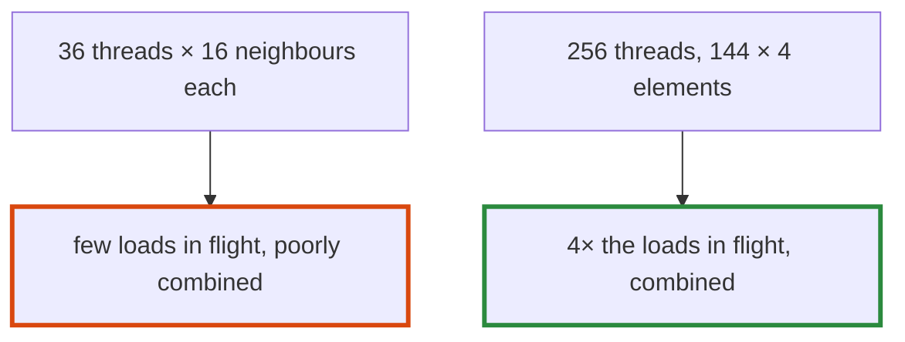

# Q-BV: Why can 256 threads with 112 idle beat 36 busy ones?

*[Quantised decoding on GPUs](README.md#quantised-decoding-on-gpus) · previous: [Q-BU](q-bu-the-heads-bandwidth.md) · next: [Q-BW](q-bw-what-grouping-saves.md)*

## The question

The new RMSNorm kernel gives a row of 576, SmolLM2-135M's width, 256 threads, but only 144 of them get any elements; the other 112 add nothing. Why might it still be faster than the old kernel's 36 threads?

> **Hint:** what does each thread wait for, and how do neighbouring threads read memory?

<strong>Answer</strong>

### In short

Three reasons. The 144 working threads each have 4 elements to load rather than 16, so four times as many loads are in flight at once, and the wait for memory overlaps. Neighbouring threads read neighbouring elements, so each memory request serves many threads, where the old kernel's threads each read 16 neighbours of their own and its requests served few. And the sum is combined in a tree of 8 steps, which is short. Idle threads cost almost nothing: they exit early.

### An analogy

Unloading a lorry: 144 people carrying 4 boxes each finish sooner than 36 carrying 16, even if another 112 people stand by doing nothing.

### Worked example

RMSNorm per call on SmolLM2-1.7B's 2,048-wide rows, where every thread has work, before and after (#102):

Machine|Old kernel|New kernel
-------|----------|----------
M5 Pro |10.3 µs   |6.2 µs    
GB10   |12.5 µs   |6.9 µs    

An `Add` of the same size takes about 3 µs: the floor for a pass over 2,048 floats.

### Where it shows up in tensomite

`rmsnorm_f32` in `metal/kernels.metal` and `cuda/kernels.cu`. It sums in a tree, so its bits differ from the host's; it is held to the host within 1e-5, and stays deterministic.

## See also

- [Q-AS](q-as-loading-ahead.md): time spent waiting for memory, not adding.
- [Q-AR](q-ar-splitting-a-sum.md): why a tree sum changes the bits.
