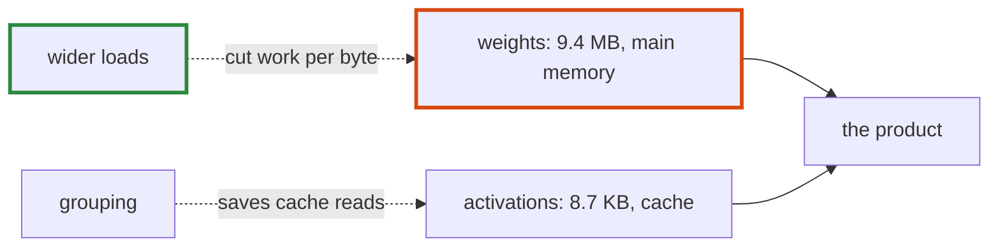

# Q-BW: For the down projection, which helps more: wider loads or grouped outputs?

*[Quantised decoding on GPUs](README.md#quantised-decoding-on-gpus) · previous: [Q-BV](q-bv-idle-threads-still-help.md) · next: [Q-CA](q-ca-scores-that-stay-on-chip.md)*

## The question

A group of four outputs reads each block of activations once instead of four times; the weights are still read once per output. For the down projection, with 2,048 outputs and 8,192 inputs, which should do more: wider loads, or the grouping?

> **Hint:** which of the two streams comes from main memory, and which from a cache?

<strong>Answer</strong>

### In short

Wider loads, on CUDA. The weights, 9.4 MB, stream from main memory once per token; the activations, 8.7 KB, sit in the cache, so reading them again per output is cheap. Grouping saves cache reads; wider loads, with `__dp4a`'s four multiply-adds an instruction, cut the work per weight byte. On the GB10 that is what happened: one output per warp was fastest. Metal, which has no `__dp4a`, was different: grouping four outputs helped by a third, because the activations' preparation, unpacking included, was shared.

### An analogy

Copying a long document from the archive: a faster photocopier helps more than keeping the cover sheet on your desk instead of fetching it each time.

### Worked example

The down projection at Q4_0:

Stream                                   |Bytes a token|Comes from       
-----------------------------------------|-------------|-----------------
weights, 2,048 × 8,192 at 18 bytes per 32|9.4 MB       |main memory, once
activations, 8,192 at 34 bytes per 32    |8.7 KB       |cache, per output

All of SmolLM2-1.7B's quantised products on the GB10: 5.68 ms a token before wider loads, 4.71 after; grouping 2, 4 or 8 outputs was no faster.

### Where it shows up in tensomite

Decision CW; `TENSOMITE_LANE_OUTPUTS` sets the outputs a group, and CUDA's default is one.

## See also

- [Q-BU](q-bu-the-heads-bandwidth.md): why a product's shape sets its bandwidth.
- [Q-BY](q-by-what-exactness-buys.md): what keeping the block order cost.
