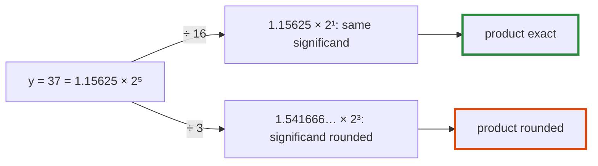

# Q-BX: Why is scaling by 1/256 exact, when dividing by 3 is not?

*[Order of addition and determinism](README.md#order-of-addition-and-determinism) · previous: [Q-AT](q-at-chunk-sums.md) · next: [Q-CE](q-ce-integers-in-any-order.md)*

## The question

Metal has no `__dp4a`, so one way to keep a quantised product exact is to leave each nibble where it sits in its byte, worth 16 times its value in the high half, and multiply by an activation scaled down to match. Why does scaling an activation by 1/256 before multiplying keep the product exact, when dividing by 3 wouldn't?

> **Hint:** how is a float stored, and which part of it does a power of two change?

<strong>Answer</strong>

### In short

A float is a significand times a power of two. Multiplying by 2⁻⁸ changes only the power, by 8, and leaves the significand's bits alone, so nothing is rounded, unless the result falls below the smallest normal float. 1/3 has no finite binary form: its significand is cut short when it is stored, and the product is rounded again. Integers shift right when divided by 256; floats keep every bit and move the binary point.

### An analogy

Moving a decimal point. 4,200 ÷ 100 is 42.00 exactly, whatever the digits; 4,200 ÷ 3 needs a decision about where to stop writing threes.

### Worked example

A quantised activation y = 37, and a high nibble q = 5, read in place as 5 × 16 = 80:

Step         |Value                                         |Exact?                  
-------------|----------------------------------------------|------------------------
y / 16       |2.3125: 37's significand, the exponent 4 lower|yes                     
80 × (y / 16)|185, which is 5 × 37                          |yes                     
y / 3        |12.333333, its significand cut to 24 bits     |no: rounded once already
(y / 3) × 3  |37 for some y, a neighbour of it for others   |only by luck            

The same holds for 1/256 and a byte's place in a 32-bit word: each step is a power of two.

### Where it shows up in tensomite

Decision CW tried this on Metal: Q4 products summed in floats, which is exact because each product is an integer below 2²⁴ and the scales are powers of two. It measured 5.29 ms a token at four outputs a group, against 5.14 for the byte-at-a-time kernel, so Metal kept the old kernel (Decision CX). The CPU's `F16` conversion uses the same fact: multiplying by 2¹¹² moves a half's exponent to a single's bias exactly ([Q-CI](q-ci-tables-against-arithmetic.md)).

## See also

- [Q-AG](q-ag-fused-multiply-add.md): another way an operation changes the bits: one rounding instead of two.
- [Q-CE](q-ce-integers-in-any-order.md): why integers can be added in any order and floats cannot.
