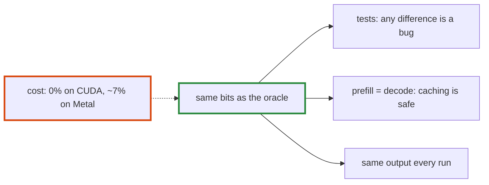

# Q-BY: What does exactness buy, and is it worth a few percent of speed?

*[Order of addition and determinism](README.md#order-of-addition-and-determinism) · previous: [Q-CE](q-ce-integers-in-any-order.md) · last in the theme*

## The question

llama.cpp sums in whatever order is fastest and accepts results that differ in the last bits. We pay to keep the host's bits exactly. What does that exactness buy us, and is it worth a few percent of speed?

> **Hint:** what would a test have to look like if two correct kernels could disagree?

<strong>Answer</strong>

### In short

Three things. One oracle: every fast kernel is checked against the naive one bit for bit, so any difference is a bug, never noise. Prefill equal to decode: a cached prefix gives the same logits as recomputing it, so prefix caching and resumed runs are safe. Reproducible runs: the same output on every run and, where the device is shape-invariant, on every batch size. The measured cost was small: nothing on CUDA, about 7% of the quantised products on Metal. My view: worth it while the cost stays in single digits, with an opt-in relaxed mode if one kernel ever costs much more.

### An analogy

A ledger that must balance to the cent. Rounding to the dollar would be faster to add up, but then no error is ever small enough to be noticed.

### Worked example

The block-order sum against the same kernel adding in a tree, `BlockMatMulMode::Unordered`, SmolLM2-1.7B at Q4_0:

Device                           |Block order|Unordered|Cost                               
---------------------------------|-----------|---------|-----------------------------------
GB10 (CUDA, `__dp4a`)            |4.71 ms    |4.88 ms  |none: the ordered kernel was faster
M5 Pro (Metal), 4 outputs a group|5.29 ms    |4.93 ms  |0.36 ms, about 7%                  

What a tolerance would cost instead: a test of a fast kernel against the oracle would need a bound, chosen by hand per op and shape, and a real bug smaller than the bound would pass.

### Where it shows up in tensomite

Decision K's levels of determinism; Decision CW's measurements of `Unordered`; `spec/block_matmul_spec.cr` compares every GPU mode but `Unordered` with the host bit for bit, and `Quant.matmul` with `Quant.matmul_reference`.

## See also

- [Q-I](q-i-exact-prefill-decode.md): why prefill is tested against decode exactly.
- [Q-CE](q-ce-integers-in-any-order.md): which sums the order applies to.
