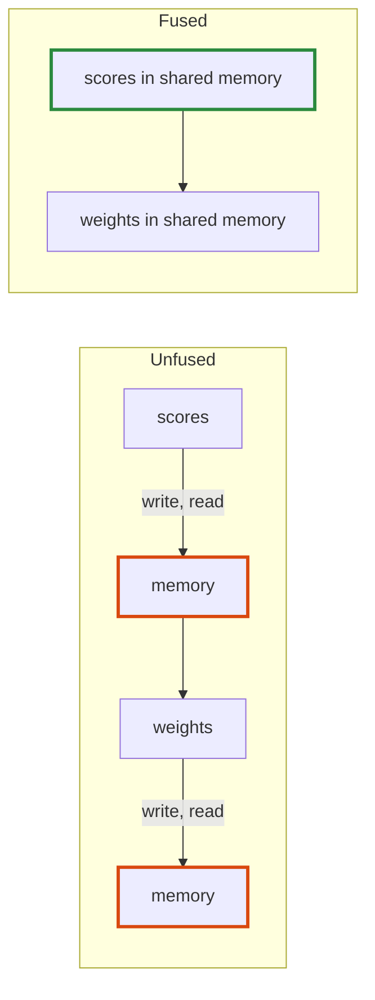

# Q-CA: Why does keeping the scores on chip matter more as the context grows?

*[Quantised decoding on GPUs](README.md#quantised-decoding-on-gpus) · previous: [Q-BW](q-bw-what-grouping-saves.md) · next: [Q-CB](q-cb-repeating-a-pass.md)*

## The question

The fused attention kernel keeps the scores in the GPU's shared memory rather than writing them out. Why does that matter more as the context grows, even though the number of dispatches stays the same?

> **Hint:** how many scores are there per head, and how many times does the unfused version move them?

<strong>Answer</strong>

### In short

Because the scores grow with the context and the dispatches do not. Unfused, each head's scores and then its softmax weights are written to memory and read back: four trips over one number per cached position, per head, per layer. At 80 positions that is little; at 4,096 it is tens of megabytes a token, as much traffic as a sizeable weight matrix. Fused, they never leave the chip, so the cost of a longer context is only the keys and values themselves.

### An analogy

Working out a sum on scrap paper on your desk, against walking each intermediate line to a filing cabinet and back. The longer the sum, the more walking you save.

### Worked example

SmolLM2-1.7B, 32 heads, 24 layers, one decoded token, scores and weights in `F32`:

Cached positions|Bytes moved unfused (write and read, scores and weights)
----------------|--------------------------------------------------------
80              |about 1 MB                                              
4,096           |about 50 MB                                             

Measured at about 80 positions, attention went from 0.73 to 0.42 ms a token on the GB10, and from 0.92 to 0.70 on the M5 Pro.

### Where it shows up in tensomite

`Tensor.attention` and `Op::Attention` (Decision CZ), for at most 8 rows per head and 4,096 positions, which fit its 16 KB of scores; longer contexts take the composite.

## See also

- [Q-G](q-g-online-softmax.md): how softmax could work tile by tile, for longer contexts.
- [Q-AO](q-ao-the-empty-slots.md): how attention reads only the filled positions.
