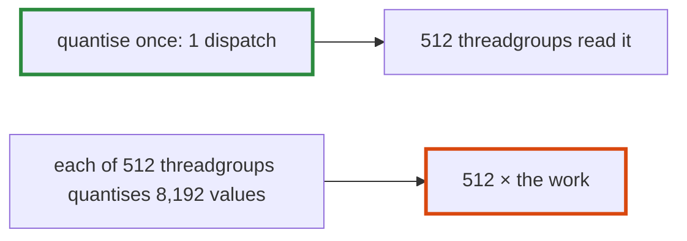

# Q-CB: Can repeating a pass in every threadgroup beat doing it once?

*[Quantised decoding on GPUs](README.md#quantised-decoding-on-gpus) · previous: [Q-CA](q-ca-scores-that-stay-on-chip.md) · next: [Q-CC](q-cc-a-launch-bound-profile.md)*

## The question

Quantising a decoded row inside each product's kernel removes a dispatch per product, but every threadgroup then quantises the same row again: the GPU repeats that work hundreds of times. Why can that still be faster than doing it once in a separate dispatch?

> **Hint:** what does the separate dispatch cost, apart from its work?

<strong>Answer</strong>

### In short

It can be when the repeated work is small beside what a dispatch costs: its launch, and the wait before the next kernel may read its output, a few microseconds each. Here it wasn't. Each threadgroup of four outputs quantised the whole row before its first product, so the down projection quantised its 8,192 activations 512 times over, and the products took twice as long. Folding one pass into another pays only when the work duplicated is small beside the dispatch saved.

### An analogy

Each cook in a kitchen grinding their own pepper saves waiting for one shared grinder, until the recipe calls for a kilo of it.

### Worked example

SmolLM2-1.7B's quantised products, a token, at Q4_0:

Machine|Separate quantising pass|Quantised in every threadgroup
-------|------------------------|------------------------------
GB10   |4.7–4.9 ms              |10.13 ms                      
M5 Pro |5.16 ms                 |8.86 ms                       

97 dispatches a token were saved, predicted to be worth about 0.3 ms; the repeated work added 3.7–5.3 ms.

### Where it shows up in tensomite

Decision DB: the activations stay quantised by their own pass, `quantize_rows_q8_f32`. The experiment was #106, closed unmerged.

## See also

- [Q-AU](q-au-fewer-launches-less-saving.md): another fusion that saved less than its launches suggested.
- [Q-CC](q-cc-a-launch-bound-profile.md): when dispatches are the cost.
