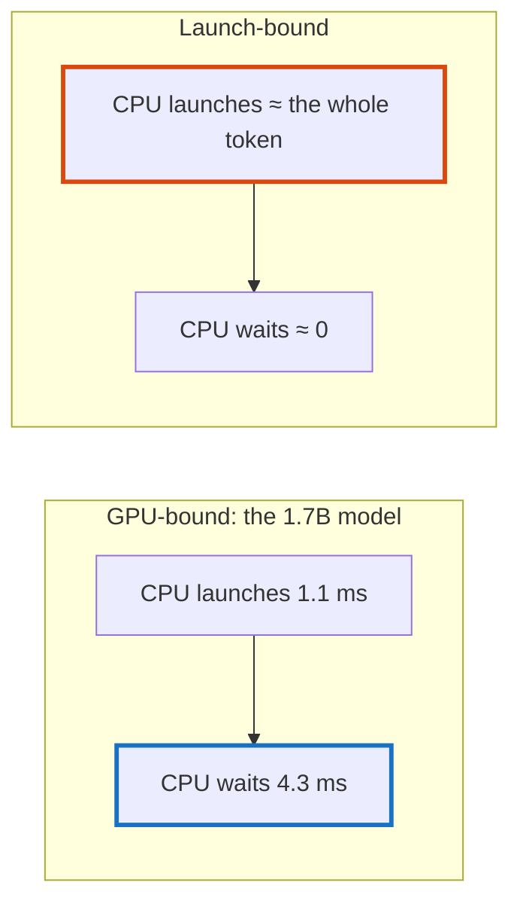

# Q-CC: What does a token bound by launches look like?

*[Quantised decoding on GPUs](README.md#quantised-decoding-on-gpus) · previous: [Q-CB](q-cb-repeating-a-pass.md) · last in the theme*

## The question

Decoding SmolLM2-1.7B on the GB10, the CPU queues every kernel in about 1.1 ms, then waits about 4.3 ms for the GPU to finish. What would you expect a profile to show for a machine that *is* limited by launches?

> **Hint:** if the CPU were the slower one, who would be waiting for whom?

<strong>Answer</strong>

### In short

The wait would shrink towards nothing and the launching would fill the token: the GPU would finish each kernel before the CPU had queued the next, and sit idle between them. So the profile would show launching close to the wall time, waiting near zero, and GPU busy time well below the wall. Only then would cutting the cost of a launch, as CUDA graphs do, shorten the token.

### An analogy

A waiter and a chef. If the chef is busy long after the last order is taken, a faster waiter changes nothing; if the chef stands idle between orders, the waiter is the bottleneck.

### Worked example

Per decoded token on the GB10, at Q4_0:

Model       |Launching kernels|Waiting for the GPU|Bound by          
------------|-----------------|-------------------|------------------
SmolLM2-1.7B|about 1.1 ms     |about 4.3 ms       |the GPU           
SmolLM2-135M|about 1.2 ms     |about 1.4 ms       |about equally both

### Where it shows up in tensomite

Decision DC deferred CUDA graphs on this reading; `bench/profile_decode_cuda.cr` reports launching and waiting separately.

## See also

- [Q-AX](q-ax-launches-not-bytes.md): a fusion whose saving was launches, not bytes.
- [Q-BT](q-bt-how-decode-scales.md): why the small model is bound by its dispatches.
