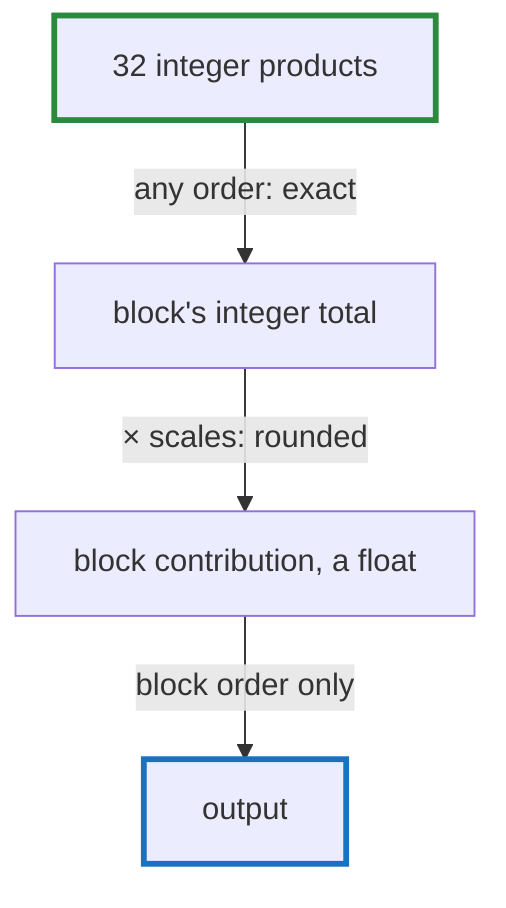

# Q-CE: Why can a block's integer sum split across lanes, but the sum over blocks not?

*[Order of addition and determinism](README.md#order-of-addition-and-determinism) · previous: [Q-BX](q-bx-scaling-by-a-power-of-two.md) · next: [Q-BY](q-by-what-exactness-buys.md)*

## The question

A quantised product's integer sum within a block can be split across SIMD lanes in any order without changing the result, but the sum over blocks can't. Why the difference?

> **Hint:** what happens to the result of each addition, in each case?

<strong>Answer</strong>

### In short

Integer addition never rounds: every partial sum is exact, so regrouping gives the same total, and wrapping arithmetic keeps that true even past overflow. Each block's contribution is a float, the integer times two scales, and every float addition rounds to 24 bits. Different groupings round at different places, so the total's last bits depend on the order. That is why tensomite adds blocks in block order everywhere, and lets the integer part go in whatever order is fastest.

### An analogy

Counting coins and weighing sacks. Coins can be counted in any order and the count is the same. A scale that rounds to the nearest kilogram gives different totals depending on which sacks go on together.

### Worked example

The theme's running example, as three block contributions: `1`, `1e8` and `−1e8`.

Grouping       |Float32 result               |As integers
---------------|-----------------------------|-----------
(1 + 1e8) − 1e8|0: 1e8 + 1 rounds back to 1e8|1          
1 + (1e8 − 1e8)|1                            |1          

Inside a block, the 32 products of a Q4 × Q8 block are integers below 128 × 16 in size, and their sum is far below 2³¹, so any split across lanes, `sdot`'s four lanes or a warp's 32, gives the same integer.

### Where it shows up in tensomite

`Quant.matmul` lets LLVM turn each block's integer sum into `sdot`, and adds the blocks' floats in order, so it gives `Quant.matmul_reference`'s bits (Decision DF). CUDA's lanes kernel takes whole blocks per lane and adds the lanes' contributions in block order for the same reason (Decision CO).

## See also

- [Q-AR](q-ar-splitting-a-sum.md): the same regrouping, in a float sum split across threads.
- [Q-BY](q-by-what-exactness-buys.md): what keeping the order buys.
