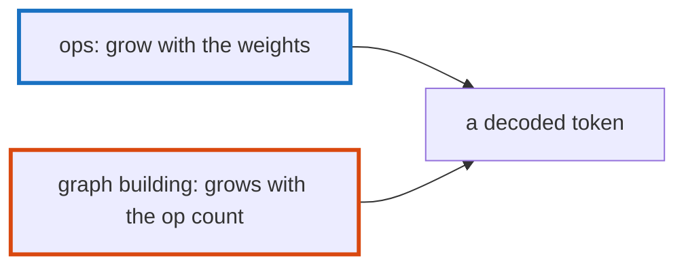

# Q-CF: Does a larger model spend a larger share of a token outside its ops?

*[CPU speed](README.md#cpu-speed) · previous: [Q-O](q-o-which-loop-vectorises.md) · next: [Q-CJ](q-cj-the-serial-share.md)*

## The question

On SmolLM2-135M, about 17% of each decoded token on the CPU was spent outside any op: building the graph and scheduling it. Will the 1.7B model, about 13 times larger, spend a larger share of its token there, or a smaller one?

> **Hint:** what does the overhead scale with, and what do the ops scale with?

<strong>Answer</strong>

### In short

Smaller. The overhead is paid once per op, and the number of ops barely depends on the model's width: about 100 quantised products a token either way. The ops' work grows with the weights they read. So the overhead stays roughly fixed while the token grows around it, and its share falls: from about 17% to 2–5%.

### An analogy

A toll per car on a road. A longer journey pays the same toll, so the toll is a smaller part of the trip.

### Worked example

Per decoded token on the CPU, at Q4_0, all threads:

Model                                  |Layers|Quantised products|Time outside the ops
---------------------------------------|------|------------------|--------------------
SmolLM2-135M (4 threads, the container)|30    |121               |about 17%           
SmolLM2-1.7B (M5 Pro, GB10)            |24    |97                |2–5%                

The 1.7B model has fewer ops than the 135M one, since it has fewer layers, but each reads about 16 times the bytes.

### Where it shows up in tensomite

`bench/profile_decode_cpu.cr` reports each op's time and their total's share of the wall time (Decision DD). With every op timed, the share is approximate: on the GB10 the timed ops added up to slightly more than the untimed wall time, because timing them costs something too.

## See also

- [Q-CJ](q-cj-the-serial-share.md): another fixed cost that grows in share: work on one thread.
- [Q-AX](q-ax-launches-not-bytes.md): the GPU's version: launches rather than bytes.
