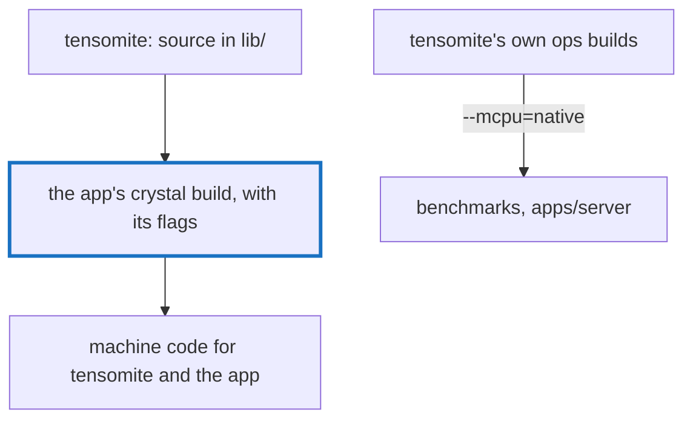

# Q-CG: Should tensomite's portable macOS build enable the 8-bit dot product?

*[CPU speed](README.md#cpu-speed) · previous: [Q-CI](q-ci-tables-against-arithmetic.md) · last in the theme*

## The question

Every Apple-silicon Mac has `sdot`, the 8-bit dot-product instruction, so a portable macOS build gives it up for nothing; a portable Linux ARM build can't assume it. Should tensomite's portable macOS build enable `+dotprod`? Consider who sets compiler flags when tensomite is a shard inside someone else's app.

> **Hint:** whose compiler run turns tensomite's source into machine code?

<strong>Answer</strong>

### In short

Tensomite can't decide it for an app. A shard is source code: the app's own `crystal build` compiles it, with the app's flags, and Crystal has no per-shard or per-function target features. What tensomite can do is say what the flag buys, as `GUIDE.md` does, and use it in its own builds: `ops bn` and `ops run-native` use `--mcpu=native`, and a macOS-only `--mattr=+dotprod` would be safe there. On Linux ARM, a board without it, such as a Raspberry Pi 4, would stop with an illegal instruction.

### An analogy

A recipe can suggest a fan oven, but the cook decides which oven it goes in.

### Worked example

SmolLM2-1.7B at Q4_0, all threads, after Decision DF:

Machine|Portable|`--mcpu=native`
-------|--------|---------------
M5 Pro |7.17 ms |6.36 ms        
GB10   |12.8 ms |11.2 ms        

`--mattr=+dotprod` alone has not been measured since Decision DF made the loop signed; before it, LLVM did not use `sdot` at all.

### Where it shows up in tensomite

Decisions DE and DF; `ops.yml`'s `build-native` and `run-native`; "Speed on the CPU" in `GUIDE.md`.

## See also

- [Q-CI](q-ci-tables-against-arithmetic.md): the same loop, where instruction counts mattered.
