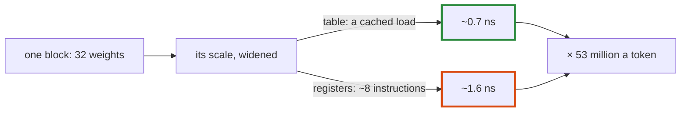

# Q-CI: How can an exact conversion with a few more instructions be slower than a table?

*[CPU speed](README.md#cpu-speed) · previous: [Q-CJ](q-cj-the-serial-share.md) · next: [Q-CG](q-cg-who-sets-the-flags.md)*

## The question

Widening each block's `F16` scale in registers, its bits moved and multiplied by 2¹¹², is exact for every half and needs no memory. Yet it made SmolLM2-1.7B's tokens 3–5 ms slower than a lookup in a 256 KB table. How can a few more instructions, and no loads, be slower than a load?

> **Hint:** how often does the conversion run, and where do the table's loads hit?

<strong>Answer</strong>

### In short

It runs once for every 32 weights of every output, about 53 million times a token for the 1.7B model, so 1 ns more each is about 53 ms of work, 2.7 ms a token on 20 threads. And the table's load is cheap: a model's scales take few distinct values, so the entries in use stay in the core's fastest cache, I think, and a cached load is a few cycles that overlap with other work. Exactness was never the cost; instructions in the hottest loop were.

### An analogy

Looking up a word you use every day in a dictionary that falls open at that page, against spelling it out letter by letter: the second is self-contained, and still slower.

### Worked example

Measured here, 1M conversions of scales like a model's, each feeding a running sum:

Conversion              |Time each   
------------------------|------------
Table lookup            |0.68–0.69 ns
In registers, branchless|1.60–1.63 ns

On the 1.7B model at Q4_0, portable builds:

Machine|Before |With the in-register conversion|With the table back
-------|-------|-------------------------------|-------------------
M5 Pro |10.7 ms|16.1 ms                        |7.17 ms            
GB10   |16.6 ms|21.0 ms                        |12.8 ms            

The last column also has the rest of Decision DF's changes.

### Where it shows up in tensomite

`Quant`'s `HALVES` table and `fast_half` (Decision DF). The in-register version lives on as `F16#to_f32`'s spec: every one of the 65,536 halves is checked against the value its bits define.

## See also

- [Q-BX](q-bx-scaling-by-a-power-of-two.md): why multiplying by 2¹¹² is exact.
- [Q-O](q-o-which-loop-vectorises.md): what LLVM can and cannot vectorise in such a loop.
