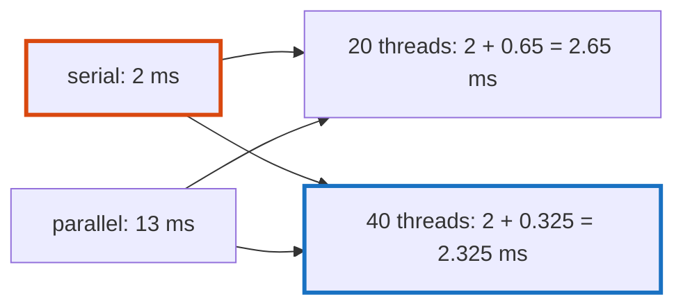

# Q-CJ: If 2 ms of a token runs on one thread, what can 20 threads do?

*[CPU speed](README.md#cpu-speed) · previous: [Q-CF](q-cf-the-share-outside-the-ops.md) · next: [Q-CI](q-ci-tables-against-arithmetic.md)*

## The question

If 2 ms of a 15 ms token runs on one thread and the rest divides perfectly among 20 threads, what is the fastest the token can be, and how much does doubling the cores then buy?

> **Hint:** which part of the 15 ms do more threads touch?

<strong>Answer</strong>

### In short

Only the 13 ms that divides: 13 / 20 = 0.65 ms, so 2.65 ms in all. Doubling the cores divides the 13 ms by 40 instead, for 2.325 ms: 12% faster for twice the hardware. The serial 2 ms is now three quarters of the token. This is Amdahl's law: the part that does not divide sets the floor, and its share grows as the rest shrinks.

### An analogy

Twenty cooks, and one of them chops all the onions while the others wait. Hiring twenty more cooks doesn't chop the onions any faster.

### Worked example

The case that prompted it, in tensomite's quantised products before #129: each product copied and quantised its activations on the calling thread before the workers started.

Per token, SmolLM2-135M, 4 threads|Serial work                       |Token       
----------------------------------|----------------------------------|------------
Before                            |2.14 ms (copy 1.17, quantise 0.97)|18.1–18.8 ms
After                             |0.23 ms                           |15.1–15.8 ms

On the GB10, one thread took 108 ms a token and 20 threads 15 ms, a speed-up of only 7. Removing the serial work, then reworking the inner loop, brought 20 threads to 12.8 ms.

### Where it shows up in tensomite

Decision DF: timers around the copy and the quantise, before anything was changed, found the serial work; `HostDevice#block_matmul` now reads dense activations in place, and `Quant.matmul` quantises through pointers.

## See also

- [Q-CF](q-cf-the-share-outside-the-ops.md): a fixed cost whose share falls as the work grows.
- [Q-CI](q-ci-tables-against-arithmetic.md): the next surprise in the same loop.
