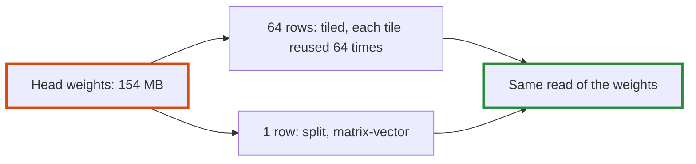

# Q-CL: Why is the last-only head less than 64 times cheaper?

*[Batched decoding](README.md#batched-decoding) · first in the theme · next: [Q-CY](q-cy-padding-changes-bits.md)*

## The question

With `forward`, a 64-row batch's head is one product `[64, 768] · [768, 50257]`. With `forward_last` it is `[1, 768] · [768, 50257]`. Why might the second be less than 64 times cheaper?

> **Hint:** which matmul mode `Auto` picks for each.

<strong>Answer</strong>

### In short

On Metal, `Auto` uses the tiled kernel at 16 rows or more and the split kernel below. The tiled kernel loads each weight tile once and reuses it across all 64 rows, so 64 rows cost far less than 64 single-row products. One row is a matrix-vector product, bound by reading the whole 154 MB head (768 × 50,257 × 4 bytes). Reading the weights dominates both, so last-only saves the arithmetic of 63 rows, not 63 reads of the head.

### An analogy

Serving one dinner to 64 guests from one pan, or to one guest from the same pan. The pan is carried from the cupboard either way; only the ladling differs.

### Worked example

The head's weights, read from memory:

Call          |Product                   |Kernel on Metal|Weights read
--------------|--------------------------|---------------|------------
`forward`     |`[64, 768] · [768, 50257]`|tiled          |154 MB once 
`forward_last`|`[1, 768] · [768, 50257]` |split          |154 MB once 

### Where it shows up in tensomite

`Generative#forward_last` (Decision DJ, #121) takes only the last position's row into the head; `Metal::MatMulMode` names the kernels that `Auto` chooses between.

## See also

- [Q-BU](q-bu-the-heads-bandwidth.md): why the head reads fastest of all the products.
