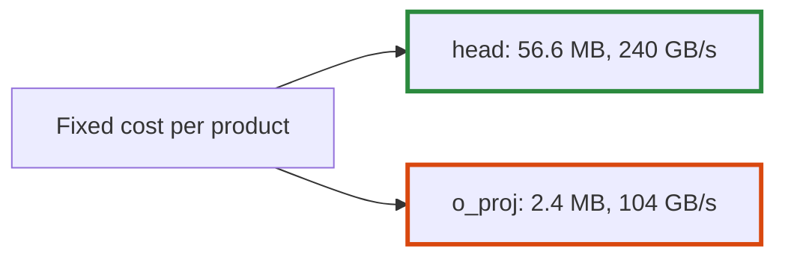

# Q-CN: Which product of a SmolLM2-1.7B token reads slowest on Metal?

*[Quantised decoding on GPUs](README.md#quantised-decoding-on-gpus) · previous: [Q-CC](q-cc-a-launch-bound-profile.md) · next: [Q-CO](q-co-a-fixed-cost-per-product.md)*

## The question

SmolLM2-1.7B has products of 2,048 → 2,048 (`o_proj`), 2,048 → 6,144 (q, k and v joined), 2,048 → 16,384 (gate and up joined), 8,192 → 2,048 (down) and the 49,152-word head. Which reads slowest on the M5 Pro, and why?

> **Hint:** which has the fewest bytes to spread a fixed cost over?

<strong>Answer</strong>

### In short

`o_proj`, the smallest: it read at 104 GB/s against 171 to 240 for the others. Each product pays a fixed cost, and `o_proj` has the fewest bytes (2.4 MB) to spread it over. So the product that moves the least data looks slowest per byte.

### An analogy

Posting letters: a trip to the post box takes the same time for one letter or twenty. Per letter, the single trip looks slow.

### Worked example

Reading speed by product on the M5 Pro, Q4_0:

Product|GB/s
-------|----
head   |240 
gate+up|215 
down   |185 
qkv    |171 
o_proj |104 

### Where it shows up in tensomite

`bench/profile_decode.cr` times each product by shape; Decision DN follows the gap.

## See also

- [Q-CO](q-co-a-fixed-cost-per-product.md): what the gap between down and `o_proj` suggests.
- [Q-BU](q-bu-the-heads-bandwidth.md): why the head reads fastest.
