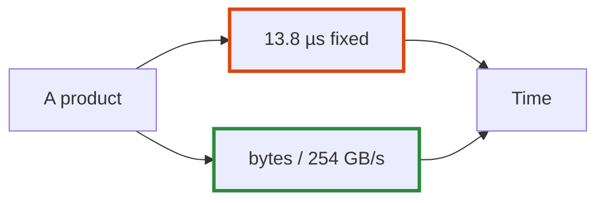

# Q-CO: What does the gap between down and `o_proj` suggest?

*[Quantised decoding on GPUs](README.md#quantised-decoding-on-gpus) · previous: [Q-CN](q-cn-the-slowest-product.md) · next: [Q-CP](q-cp-the-profilers-own-cost.md)*

## The question

The down product (2,048 outputs, rows of 8,192) reads at 185 GB/s and `o_proj` (2,048 outputs, rows of 2,048) at 104. If too few outputs to fill the GPU were the problem, both would read alike, as they have the same number of outputs. What does the gap suggest instead?

> **Hint:** what do the two share, and what differs?

<strong>Answer</strong>

### In short

A fixed cost per product, not a shortage of outputs. Every product took about 13.8 µs plus its bytes at 254 GB/s, which fits all five shapes to within 1 µs. The same 14 µs is a quarter of down's time and 60% of `o_proj`'s.

### An analogy

A ferry with a fixed loading time: a lorry and a bicycle both wait the same at the quay, so the bicycle's crossing looks far slower per kilogram.

### Worked example

Time per product on the M5 Pro:

Product|Bytes  |Time   
-------|-------|-------
gate+up|18.9 MB|88.1 µs
down   |9.4 MB |52.0 µs
qkv    |7.1 MB |41.7 µs
o_proj |2.4 MB |23.1 µs
head   |56.6 MB|237 µs 

The line `13.8 µs + bytes / 254 GB/s` passes within 1 µs of each. Of down's 52 µs, 13.8 is 27%; of `o_proj`'s 23.1, it is 60%.

### Where it shows up in tensomite

Decision DN fitted the line to the five shapes and took the fixed part as the next target.

## See also

- [Q-CN](q-cn-the-slowest-product.md): which product reads slowest.
- [Q-CP](q-cp-the-profilers-own-cost.md): whether the profiler itself could be the 14 µs.
