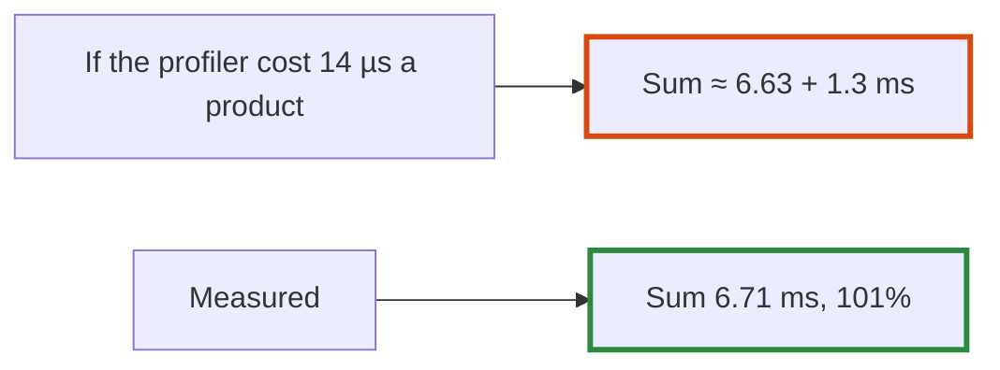

# Q-CP: Could the 14 µs be the profiler's own cost?

*[Quantised decoding on GPUs](README.md#quantised-decoding-on-gpus) · previous: [Q-CO](q-co-a-fixed-cost-per-product.md) · next: [Q-CQ](q-cq-the-floor-of-a-dispatch.md)*

## The question

The profiler times each op in its own command buffer. If the 14 µs per product were the profiler's cost, how would the per-kernel GPU total compare with the normal run's wall time?

> **Hint:** 97 products a token; how much extra would that add?

<strong>Answer</strong>

### In short

It would exceed the wall time by about 1.3 ms (97 products × 14 µs). It did not: the total came to 101% of the wall time (6.71 ms against 6.63), so the cost is in the GPU's work, not in the profiler. Later, with the quantise timed apart, the total was 110%.

### An analogy

Timing each leg of a journey by stopping at every station: if the stops added the delay, the legs would sum to far more than the journey. They did not.

### Worked example

A token on the M5 Pro:

Quantity                           |Value         
-----------------------------------|--------------
Products a token                   |97            
Profiler cost if it were 14 µs each|about 1.3 ms  
Wall time, normal run              |6.63 ms       
Sum of per-kernel times            |6.71 ms (101%)

### Where it shows up in tensomite

`Metal::Profile` in per-kernel mode; Decision DN.

## See also

- [Q-CO](q-co-a-fixed-cost-per-product.md): the fixed cost the profile found.
