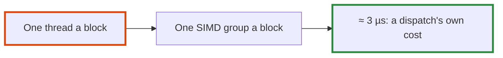

# Q-CQ: How cheap can the activations' quantise get?

*[Quantised decoding on GPUs](README.md#quantised-decoding-on-gpus) · previous: [Q-CP](q-cp-the-profilers-own-cost.md) · next: [Q-CR](q-cr-latency-at-few-outputs.md)*

## The question

After the activations' quantise ran one SIMD group per block instead of one thread per block, would a call take nearer 1 µs or 6 µs (like RMSNorm)?

> **Hint:** which op in the token does nothing but a dispatch?

<strong>Answer</strong>

### In short

Nearer 3 µs: 3.4 µs for a row of 2,048 and 3.0 µs for 8,192, the same as an `Add`. That is the cost of a dispatch itself, and it cannot go lower without removing the dispatch. The token went from 6.63 to 6.10 ms, and the product's own fixed cost was then 7.4 µs.

### An analogy

Posting a card: once you have stopped writing a long letter, the walk to the post box is what is left.

### Worked example

Per call on the M5 Pro:

Op                    |Time      
----------------------|----------
`Add`                 |about 3 µs
quantise, row of 2,048|3.4 µs    
quantise, row of 8,192|3.0 µs    
RMSNorm               |about 6 µs

The token went from 6.63 ms to 6.10 ms.

### Where it shows up in tensomite

`quantize_rows_q8_f32` in `metal/kernels.metal`; Decision DN.

## See also

- [Q-BR](q-br-joining-projections.md): why tiny products cost a fixed minimum.
- [Q-CO](q-co-a-fixed-cost-per-product.md): the fixed cost per product.
