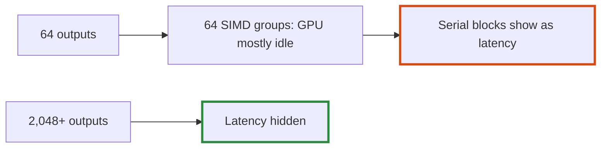

# Q-CR: Is the fixed cost all dispatch?

*[Quantised decoding on GPUs](README.md#quantised-decoding-on-gpus) · previous: [Q-CQ](q-cq-the-floor-of-a-dispatch.md) · next: [Q-CS](q-cs-loads-that-must-stay.md)*

## The question

In `bench/dispatch_metal.cr`'s third table (n = 64 outputs, tiny weights), if the fixed cost were all dispatch, how would the time change from k = 512 to k = 8,192?

> **Hint:** what does a dispatch cost, and does it depend on k?

<strong>Answer</strong>

### In short

It would stay flat. It grew, from 4.45 through 5.38 to 9.87 µs, while the bytes read added only about 1 µs. At 64 outputs only 64 SIMD groups run on the GPU, so each lane's serial walk over its blocks shows as latency. Real products have 2,048 or more outputs, which hide it.

### An analogy

One cashier serving a queue of 8,000 items: with 2,000 cashiers open the queue is hidden, with 64 the length of each queue is felt.

### Worked example

Third table, 64 outputs, tiny weights, after the bench was fixed to time long, warmed runs:

Reading                               |Time                    
--------------------------------------|------------------------
If all dispatch: k = 512 and k = 8,192|equal                   
Measured, k = 512                     |4.45 µs                 
Measured, k = 2,048                   |5.38 µs                 
Measured, k = 8,192                   |9.87 µs                 
Bytes read, k = 512 to 8,192          |about 1 µs of the 5.4 µs

The first version of the bench disagreed with itself: the same shape timed 33.7 µs and 14.2 µs, because each realise's wait was spread over few dispatches and the GPU idled between short bursts.

### Where it shows up in tensomite

`bench/dispatch_metal.cr`; Decision DP.

## See also

- [Q-CO](q-co-a-fixed-cost-per-product.md): the fixed cost the table is probing.
