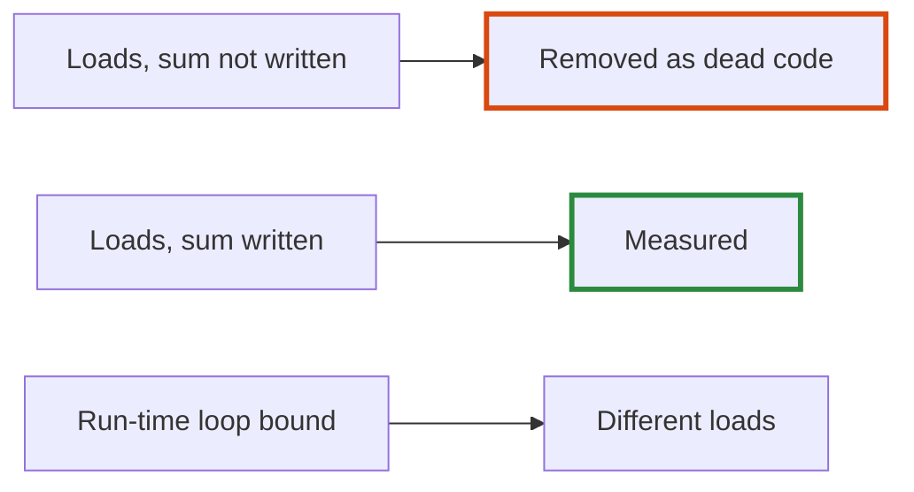

# Q-CS: Why must a measurement mode's loads stay exactly as they are?

*[Quantised decoding on GPUs](README.md#quantised-decoding-on-gpus) · previous: [Q-CR](q-cr-latency-at-few-outputs.md) · next: [Q-CT](q-ct-splitting-the-gap.md)*

## The question

A measurement mode loads each block's bytes as the real kernel does but only adds them up, giving a wrong answer. Why must the loads stay exactly as they are, and the sum be written out?

> **Hint:** what does a compiler do with a value nobody uses?

<strong>Answer</strong>

### In short

A compiler removes loads whose values are never used (dead-code elimination), so without writing the sum the mode would measure nothing. The loads must also compile to the same instructions as the kernel's. A first version used a loop bound known only at run time and ran 20% slower than the real kernel: it compiled to different loads. With byte counts fixed per format it measured as intended.

### An analogy

Timing how long it takes to read a book, but skipping any page you will not be quizzed on: you would time the skipping.

### Worked example

Two versions of the `loads` mode:

Version                          |Against the real kernel
---------------------------------|-----------------------
Loop bound known only at run time|20% slower             
Byte counts fixed per format     |as intended            

### Where it shows up in tensomite

`BlockMatMulMode::Loads`; Decisions DP and DQ.

## See also

- [Q-CT](q-ct-splitting-the-gap.md): using the modes to split a gap.
