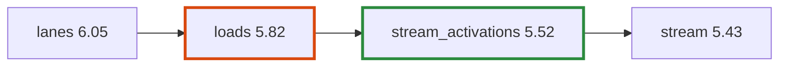

# Q-CT: How do you tell how much of the gap is the activations?

*[Quantised decoding on GPUs](README.md#quantised-decoding-on-gpus) · previous: [Q-CS](q-cs-loads-that-must-stay.md) · next: [Q-CU](q-cu-rewrite-or-repack.md)*

## The question

`stream` reads only the weights, as 16-byte words. `loads` reads the weights byte by byte and 32 activations per block. If `stream` beats `loads`, how do you tell how much of the gap is the activations?

> **Hint:** add one mode between them.

<strong>Answer</strong>

### In short

Add a mode that reads the weights as `stream` does and the activations as the kernel does (`stream_activations`). Then stream against stream_activations is the activations, and stream_activations against loads is the byte-wise weight loads.

### An analogy

Weighing a suitcase, then adding the coat, then the shoes: each difference is one item's weight.

### Worked example

A token on the M5 Pro:

Mode              |Time   |Step to the next              
------------------|-------|------------------------------
lanes             |6.05 ms|arithmetic 0.23 ms            
loads             |5.82 ms|byte-wise weight loads 0.30 ms
stream_activations|5.52 ms|activations 0.09 ms           
stream            |5.43 ms|                              

### Where it shows up in tensomite

`BlockMatMulMode`; Decision DQ.

## See also

- [Q-CS](q-cs-loads-that-must-stay.md): why the modes' loads must match the kernel's.
- [Q-CU](q-cu-rewrite-or-repack.md): what the split points to.
