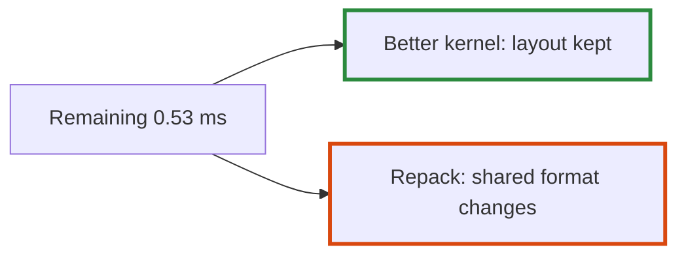

# Q-CU: Rewrite the kernel's loads, or repack the weights?

*[Quantised decoding on GPUs](README.md#quantised-decoding-on-gpus) · previous: [Q-CT](q-ct-splitting-the-gap.md) · next: [Q-CV](q-cv-threadgroup-memory-loads.md)*

## The question

If the activations cost almost nothing, why would rewriting the kernel's loads be a better bet than repacking the weights into an aligned layout?

> **Hint:** who else reads the weights in ggml's block layout?

<strong>Answer</strong>

### In short

The remaining 0.53 ms is how the kernel reads and uses the weights. A better kernel can fix both while keeping ggml's block layout, which `Gather`, CUDA and the host share. Repacking changes that shared format, mostly to make reading easier, which a better kernel gets anyway. This is not yet built: Decision DR proposes staging blocks through threadgroup memory.

### An analogy

Fixing how you carry the shopping rather than asking every shop to repack it.

### Worked example

Left after the activations (M5 Pro, a token):

Part                  |Time   
----------------------|-------
arithmetic            |0.23 ms
byte-wise weight loads|0.30 ms
Together              |0.53 ms

### Where it shows up in tensomite

Decision DQ weighed the two; Decision DR is the proposed kernel.

## See also

- [Q-CT](q-ct-splitting-the-gap.md): how the 0.53 ms was found.
- [Q-CV](q-cv-threadgroup-memory-loads.md): why staging through threadgroup memory should be cheaper.
