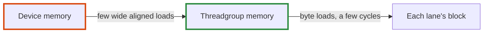

# Q-CV: Why are byte loads from threadgroup memory cheaper?

*[Quantised decoding on GPUs](README.md#quantised-decoding-on-gpus) · previous: [Q-CU](q-cu-rewrite-or-repack.md) · last in the theme*

## The question

In Decision DR's proposal each lane still reads its block a byte at a time, now from threadgroup memory. Why would that be cheaper than reading the same bytes from device memory, with the same number of load instructions?

> **Hint:** how far away is each memory, and how much does one fetch bring?

<strong>Answer</strong>

### In short

This is reasoning, not a measurement: DR is not yet built. Threadgroup memory is on-chip SRAM a few cycles away. Device-memory loads go through caches with far longer latency and fetch whole cache lines, and an 18-byte block straddles lines unevenly. Copying 32 blocks (576 bytes) once as aligned 16-byte words, spread across the lanes as `stream` reads them, turns many scattered slow loads into a few wide ones.

### An analogy

Fetching a pile of papers from the archive in one trip to your desk, then reading them there, rather than walking to the archive for each page.

### Worked example

One staged tile:

Item           |Size                               
---------------|-----------------------------------
Block (Q4_0)   |18 bytes                           
Blocks per tile|32                                 
Tile           |576 bytes, as aligned 16-byte words

### Where it shows up in tensomite

Decision DR (proposed).

## See also

- [Q-CU](q-cu-rewrite-or-repack.md): why rewrite the loads rather than repack.
