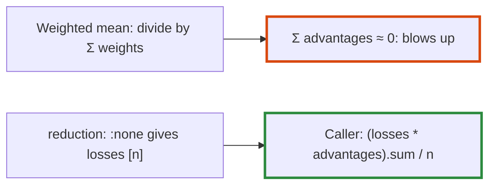

# Q-CX: Why can't a weighted mean give advantage-weighted loss?

*[Fine-tuning](README.md#fine-tuning) · previous: [Q-BP](q-bp-more-from-xl.md) · last in the theme*

## The question

A caller wants each token's loss scaled by an advantage. Why can't it get that by passing weights that sum to 1 into a weighted mean?

> **Hint:** what does a weighted mean divide by?

<strong>Answer</strong>

### In short

A weighted mean divides by the sum of the weights. Advantages can be negative and sum to about zero, so that division blows up or flips sign. Tensomite therefore gives each row's loss (`reduction: :none`, shape `[n]`) and the caller writes the reduction, `(losses * advantages).sum / n`, at one value per token. The alternative, a `[positions, vocab]` mask, would take about 270 MB a step at vocabulary 8k and 16 × 512 tokens.

### An analogy

Splitting a bill by shares: if some shares are credits that cancel the rest, dividing by their total is dividing by nearly nothing.

### Worked example

Size of a mask against a vector, at vocabulary 8,192 and 16 × 512 = 8,192 tokens:

Form                     |Values   |Float32     
-------------------------|---------|------------
`[positions, vocab]` mask|about 67M|about 270 MB
`[n]` advantages         |8,192    |32 KB       

### Where it shows up in tensomite

`Tensor#cross_entropy` (Decision DS, 0.4.0).

## See also

- [Q-BC](q-bc-what-a-checkpoint-holds.md): another fine-tuning detail left to the caller.
