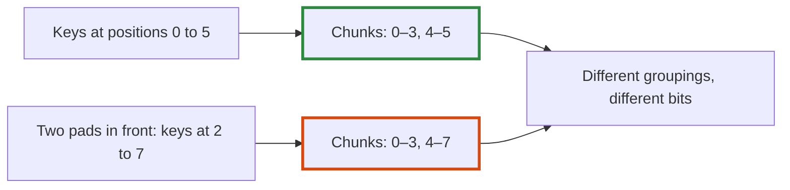

# Q-CY: Why does left padding change a softmax's bits?

*[Batched decoding](README.md#batched-decoding) · previous: [Q-CL](q-cl-last-position-head.md) · next: [Q-DA](q-da-the-cost-of-each-row.md)*

## The question

Left padding puts masked positions before a sequence's real keys, and their weights are exactly zero. Why does it still change the bits of the sequence's softmax?

> **Hint:** where does each chunk of a sum begin?

<strong>Answer</strong>

### In short

The zeros are harmless; the shift is not. Sums over positions are taken in fixed chunks from position 0 (16 for the softmax, 64 for the weighted values). Padding moves the real keys to later positions, so different keys share a chunk, and float addition is not associative. The packed design keeps each row's keys where they would be alone.

### An analogy

Adding a receipt four lines at a time: two blank lines at the top change every subtotal, though the total of the amounts is the same.

### Worked example

In Float32:

Grouping       |Result
---------------|------
(1e8 + 1) − 1e8|0     
1e8 + (1 − 1e8)|1     

Same numbers, grouped differently, give different bits.

### Where it shows up in tensomite

Decision DT chose a packed layout over padding.

## See also

- [Q-CE](q-ce-integers-in-any-order.md): when order does not matter.
- [Q-AT](q-at-chunk-sums.md): why every chunk sum is written.
