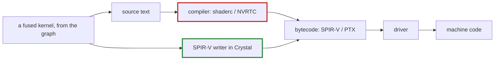

# Q-D: Why would a SPIR-V writer need no compiler, though it makes kernels at run time?

*[Fusion and kernels](README.md#fusion-and-kernels) · first in the theme · next: [Q-E](q-e-matmul-fusion.md)*

## The question

A GPU kernel goes through two compile steps: source text to a portable bytecode (SPIR-V for Vulkan, PTX for CUDA), then bytecode to the GPU's own machine code. For fused kernels on Vulkan, one option was a SPIR-V writer in Crystal. Why would that remove the need for any compiler in the program, even though fused kernels would still be generated while it runs?

> **Hint:** which of the two steps does a compiler like `glslc` or shaderc do, and who always does the other?

<strong>Answer</strong>

### In short

A compiler such as shaderc turns source text into SPIR-V: step one. The driver turns SPIR-V into machine code: step two, always on the user's machine, whatever else happens. A SPIR-V writer skips step one by emitting the bytecode directly, as bytes, from the graph, so there is no source text left to compile. The program writes SPIR-V; the driver, which is already there, does the rest.

### An analogy

Translating a recipe from English into a standard kitchen shorthand, which every kitchen then turns into its own notes. A translator is only needed if you start in English. Write the shorthand yourself and you need no translator, and the kitchens still make their own notes as usual.

### Worked example

`gelu` as a fused kernel, by each route:

Route                                    |Step 1: to bytecode                                 |Step 2: to machine code
-----------------------------------------|----------------------------------------------------|-----------------------
hand-written GLSL, compiled at build time|`glslc` on the developer's machine                  |the driver             
GLSL generated at run time               |shaderc, inside the program: a third library to bind|the driver             
SPIR-V written at run time               |tensomite's own writer: no compiler                 |the driver             
CUDA, as built in M8                     |NVRTC, CUDA source to PTX, at run time              |the driver             
Metal                                    |none: the driver takes source text                  |the driver             

### Where it shows up in tensomite

Decision J settled the question differently: kernels are fused at compile time, by `Tensomite.kernel` macros that turn an expression into one CPU loop, one MSL kernel and, since M8, one CUDA kernel, so nothing is generated from the graph at run time. The CUDA device compiles source with NVRTC when a kernel is first used (Decision AU), the counterpart of Metal taking source text.

## See also

- [Q-E](q-e-matmul-fusion.md): what fusion buys, and why matmul is different.
