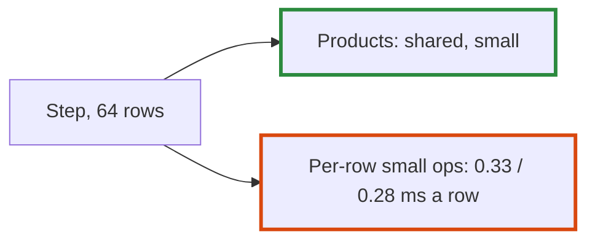

# Q-DA: Why does doubling the rows nearly double a step?

*[Batched decoding](README.md#batched-decoding) · previous: [Q-CY](q-cy-padding-changes-bits.md) · next: [Q-DB](q-db-where-a-step-waits.md)*

## The question

At 64 rows, doubling the rows nearly doubles a decoding step, though the products' cost barely changes. Why?

> **Hint:** what does each row bring that a product does not share?

<strong>Answer</strong>

### In short

Each row brought its own small ops: attention, two rotations and two cache writes per layer, about 25 per row per layer. Past 32 rows each row added a fixed 0.33 ms a step on Metal and 0.28 ms on CUDA. The products are shared across rows and cost little.

### An analogy

A shared kitchen: the chopping is done once, but each table's waiter still walks to the pass.

### Worked example

A 64-row step at 0.5.0:

Device|Step   |Products only
------|-------|-------------
M5 Pro|22.1 ms|about 2.2 ms 
GB10  |17.7 ms|about 1.3 ms 

### Where it shows up in tensomite

Decision DU; `bench/batched_decode.cr`.

## See also

- [Q-DB](q-db-where-a-step-waits.md): where the step's time goes.
- [Q-DC](q-dc-fewer-wider-ops.md): the first fix.
