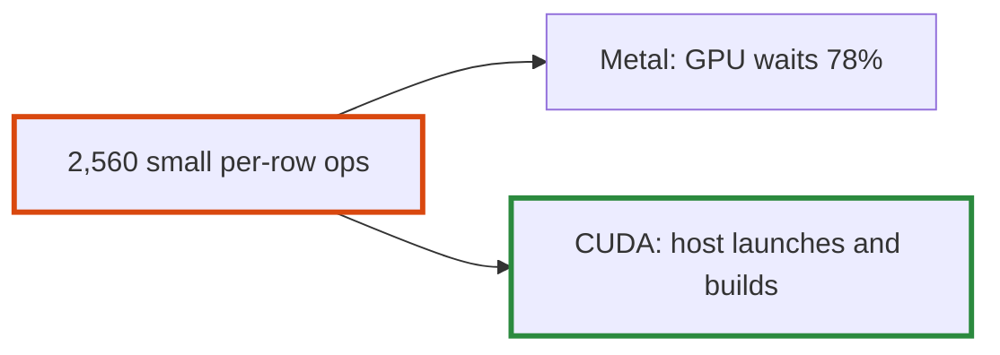

# Q-DB: Does a 64-row step mostly wait for the GPU?

*[Batched decoding](README.md#batched-decoding) · previous: [Q-DA](q-da-the-cost-of-each-row.md) · next: [Q-DC](q-dc-fewer-wider-ops.md)*

## The question

Would "waiting for the GPU" be more or less than half of a 64-row step on Metal? What do the matching per-row costs on Metal and CUDA suggest?

> **Hint:** the per-row costs were alike; were their causes?

<strong>Answer</strong>

### In short

More: 17.8 of 22.8 ms on the M5 Pro (78%). On the GB10 the host dominated: 8.2 ms launching and 4.9 ms building the graph, against 4.0 ms waiting. The equal cost per row hid two causes. What the two shared was 2,560 small per-row ops (512 attentions, 1,024 rotations, 1,024 writes). The guess that the host set the pace held only on CUDA.

### An analogy

Two restaurants with the same slow service: in one the kitchen is the bottleneck, in the other the waiters.

### Worked example

A 64-row step, from `--profile 64`:

Where the time went          |M5 Pro       |GB10   
-----------------------------|-------------|-------
Waiting for the GPU          |17.8 ms (78%)|4.0 ms 
Encoding (Metal) or launching|1.9 ms       |8.2 ms 
Building the graph           |2.8 ms       |4.9 ms 
Step                         |22.8 ms      |17.5 ms

### Where it shows up in tensomite

`bench/batched_decode.cr --profile 64`; Decision DU.

## See also

- [Q-DA](q-da-the-cost-of-each-row.md): the per-row cost.
- [Q-DC](q-dc-fewer-wider-ops.md): what cutting the ops did.
