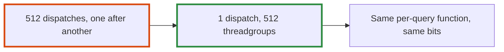

# Q-DE: Why one dispatch for all rows' attention?

*[Batched decoding](README.md#batched-decoding) · previous: [Q-DD](q-dd-a-ragged-attention-kernel.md) · last in the theme*

## The question

Why can't the fused attention kernel give each (row, head) its own dispatch, as the per-row path did, and still be fast?

> **Hint:** what does each dispatch cost, and do they overlap?

<strong>Answer</strong>

### In short

Each dispatch has a fixed cost and they run one after another. 512 tiny ones pay it 512 times with the GPU mostly idle; one dispatch of 512 threadgroups pays it once and runs them side by side. Each row keeps its bits: the ragged kernel calls the same per-query function as `Op::Attention`.

### An analogy

One bus for 512 passengers rather than 512 taxis leaving one after another.

### Worked example

Stage 3, 64 rows:

Quantity   |Before |After                   
-----------|-------|------------------------
Step, Metal|16.2 ms|3.8 ms (15,934 tokens/s)
Step, CUDA |10.8 ms|2.7 ms (22,382 tokens/s)
Dispatches |1,166  |150                     

Products are now 62% (Metal) and 50% (CUDA) of GPU time.

### Where it shows up in tensomite

`Op::RaggedAttention`, `Tensor.ragged_attention`; Decision DV stage 3 (0.6.0).

## See also

- [Q-DD](q-dd-a-ragged-attention-kernel.md): why the kernel is ragged.
