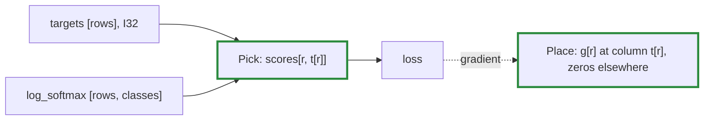

# Q-DH: Why a new op to pick each row's target?

*[Ready for autoresearch](README.md#ready-for-autoresearch) · first in the theme · next: [Q-DI](q-di-the-size-of-the-losss-gradient.md)*

## The question

`cross_entropy` used to read its targets on the host to build `row × classes + target` for a `gather`. Why add `Pick` and `Place` rather than compute those indices with tensor arithmetic on the device?

> **Hint:** which devices have kernels for `I32` arithmetic, and what would a one-hot product need?

<strong>Answer</strong>

### In short

The GPUs have kernels for `F32` only, so `I32` arithmetic runs on the host there: computing the indices as tensors would bring back the very wait it was meant to remove. A one-hot product avoids integers but needs a `[classes, classes]` identity, 10 GB at GPT-2's vocabulary. `Pick` reads row *r*'s element at column `targets[r]` directly, and `Place`, its adjoint, writes `g[r]` back there; both are copies, so the loss keeps its bits.

### An analogy

A waiter who takes one dish from each table by its order number, rather than one who first walks to the office to look up where every dish sits.

### Worked example

Three rows of four classes, targets `[2, 0, 3]`:

Route                 |What runs                                                |On a GPU                          
----------------------|---------------------------------------------------------|----------------------------------
Flat gather, as before|host reads `[2, 0, 3]`, uploads `[2, 4, 11]`             |a wait, then a gather             
Index arithmetic      |`I32` multiply and add on `[0, 1, 2]` and targets        |host ops, so a wait               
One-hot product       |a `[4, 4]` identity gathered by targets, times the scores|fine at 4 classes; 10 GB at 50,257
`Pick`                |one thread per row reads `scores[r, targets[r]]`         |one dispatch, no wait             

### Where it shows up in tensomite

`Tensor#pick` and `#place` (`Op::Pick`, `Op::Place`) on the host, Metal and CUDA; `cross_entropy`; Decision DZ, G-05 (#161).

## See also

- [Q-DI](q-di-the-size-of-the-losss-gradient.md): what `Place` costs at GPT-2's vocabulary.
