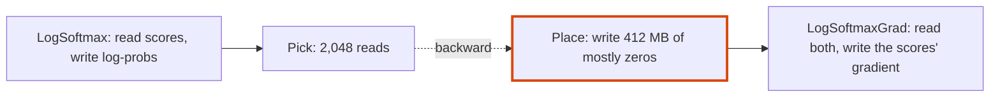

# Q-DI: Why did `Place` take 2 ms, not 0.1?

*[Ready for autoresearch](README.md#ready-for-autoresearch) · previous: [Q-DH](q-dh-a-new-op-to-pick-targets.md) · next: [Q-DJ](q-dj-recovering-merges-from-ranks.md)*

## The question

Cross-entropy's gradient took about 0.1 ms in the Shakespeare model. In a GPT-2 small training step on the GB10, `Place [2048,50257]` took 2.09 ms. Is the new kernel slow?

> **Hint:** how many bytes does it write, and how many classes did the Shakespeare model have?

<strong>Answer</strong>

### In short

No: it is the vocabulary. The gradient of the loss with respect to the scores has one element per row and class, mostly zeros. Shakespeare's model has 65 characters; GPT-2 has 50,257, so the same gradient is about 770 times larger: 412 MB, written at about 197 GB/s, near the GB10's memory bandwidth. The old route wrote the same zeros.

### An analogy

Addressing one envelope per house costs the same per envelope in a village and a city; the city just has more houses.

### Worked example

Model      |Rows |Classes|Gradient elements|Bytes (F32)|Time          
-----------|-----|-------|-----------------|-----------|--------------
Shakespeare|2,048|65     |133,120          |0.5 MB     |about 0.1 ms  
GPT-2 small|2,048|50,257 |102,926,336      |412 MB     |2.09 ms (GB10)

412 MB in 2.09 ms is about 197 GB/s. With `LogSoftmax` (13.9 ms) and `LogSoftmaxGrad` (10.3 ms), each a pass over the same `[2048, 50257]` scores, cross-entropy is about 26 ms of a 384 ms step.

### Where it shows up in tensomite

`bench/train_gpt2.cr --profile`; Decision EA puts a fused cross-entropy, one pass per row giving the loss and `softmax − one_hot` directly, in M14 (#183).

## See also

- [Q-AW](q-aw-counting-passes-over-memory.md): counting passes over memory.
- [Q-DH](q-dh-a-new-op-to-pick-targets.md): why `Place` exists.
