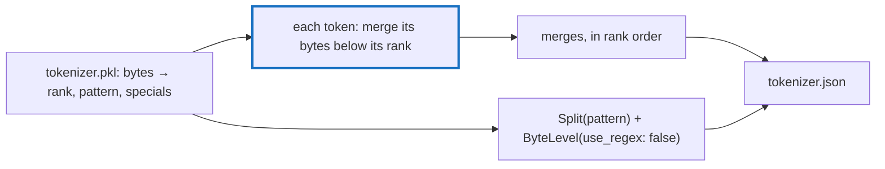

# Q-DJ: How can a tiktoken file become a `tokenizer.json`?

*[Ready for autoresearch](README.md#ready-for-autoresearch) · previous: [Q-DI](q-di-the-size-of-the-losss-gradient.md) · next: [Q-DK](q-dk-one-module-or-many.md)*

## The question

A `tiktoken` encoding stores each token's bytes and rank, but no merge list. `BPE` needs merges. Where do they come from?

> **Hint:** a token of rank *r* was made by joining two tokens. Which two can it have been?

<strong>Answer</strong>

### In short

Replay tiktoken's own merging on the token's bytes, using only tokens ranked below it: the last join is the token's merge. Ranks order merges the same way merge lists do, so writing them in rank order gives a `BPE` that encodes as tiktoken does, bit for bit. The split pattern becomes a `Split` pre-tokeniser, which `BPE.from_json` reads.

### An analogy

Reconstructing a recipe from the finished dish and a list of what was cooked first: whatever came last must have been made from things cooked earlier.

### Worked example

Ranks `t`, `h`, `e` (bytes), then `th` (256), `the` (257). For `the`, merging below 257: `t h e` → `th e` (rank 256 is the lowest pair) → two parts left, `th` and `e`. So the merge is `th e`. GPT-2's byte map turns bytes into printable characters, so a space becomes `Ġ`, as in any byte-level `tokenizer.json`.

### Where it shows up in tensomite

`scripts/tiktoken_to_json.py`; `BPE.new(..., pattern:)`; `spec/fixtures/tiktoken/`, from tiktoken's own trainer; D-01 (#166).

## See also

- [Q-DH](q-dh-a-new-op-to-pick-targets.md): the next gap closed for autoresearch.
