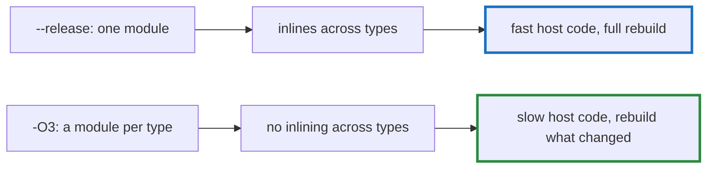

# Q-DK: Why does `-O3` rebuild fast but run the host slowly?

*[Ready for autoresearch](README.md#ready-for-autoresearch) · previous: [Q-DJ](q-dj-recovering-merges-from-ranks.md) · last in the theme*

## The question

A `--release` build of a GPT-2 training program takes 17.6 s after a one-line change on the GB10; `-O3` takes 2.2 s. `-O3` runs 30 `BLAS` training steps three times slower, yet a GPU training step just as fast. Why both?

> **Hint:** what does `--release` add to `-O3`, and where does a GPU step spend its host time?

<strong>Answer</strong>

### In short

`--release` is `-O3` plus `--single-module`: the whole program goes to LLVM as one unit, so it can inline across types, and any change reoptimises all of it. Without it, each type is its own module and only changed ones are rebuilt, but small methods called across types are no longer inlined. Host kernels on `BLAS` and `CPU` are full of such calls. On a GPU the host only builds and launches the graph, about 17 ms of a 384 ms step, so the slower host barely shows.

### An analogy

Re-editing a whole book after changing one sentence, against re-editing one chapter but losing the cross-references between chapters. A reader who mostly looks at the pictures, the GPU's work, hardly notices.

### Worked example

Machine|Build      |After an edit|Training step
-------|-----------|-------------|-------------
GB10   |`--release`|17.6 s       |383.5 ms     
GB10   |`-O3`      |2.2 s        |385.4 ms     
M5 Pro |`--release`|8.9 s        |749.0 ms     
M5 Pro |`-O3`      |1.7 s        |737.8 ms     

In the container, `-O2` in one module built no faster than `--release` (37 s) and ran slower (4.2 s against 3.1 s for 30 `BLAS` steps), so the split, not the level, is the trade. For five-minute experiments, a release rebuild costs about 6% of each on the GB10; `-O3` under 1%.

### Where it shows up in tensomite

`scripts/time_builds.sh`; "Which build" in `GUIDE.md`; "Building" in `DESIGN.md`'s baselines; Decision EB, G-09 (#165).

## See also

- [Q-CF](q-cf-the-share-outside-the-ops.md): the host's share of a step.
